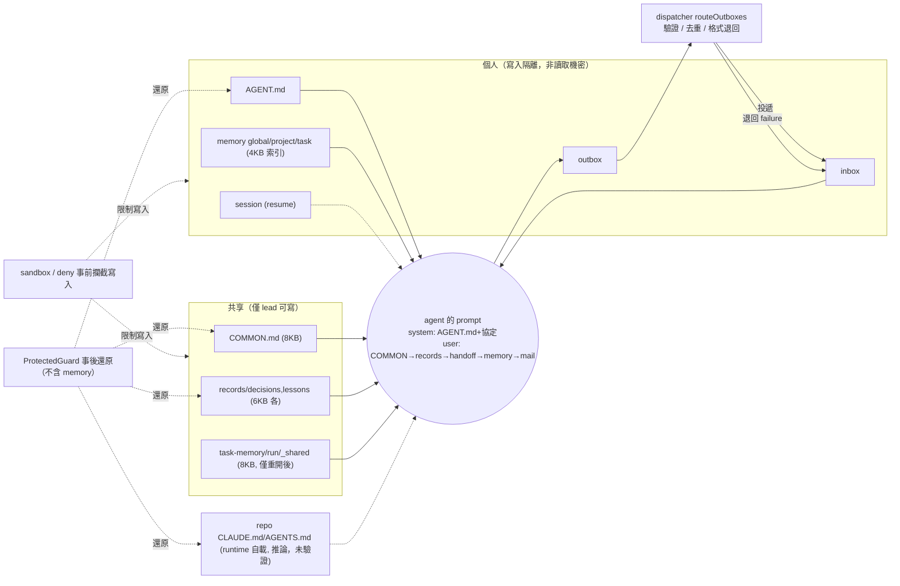

# 分析報告：agent 之間 context 的共享與分離，以及 mail 如何傳遞／覆蓋內容

本報告根據目前 repo 的程式碼與文件撰寫，引用格式為 `路徑:行號`。沒有程式碼依據的地方明說「無明確規則」；推論但未驗證的以「推論，未驗證」標示。

## 摘要

- 所有 agent 每次醒來都會在 user prompt 最前面看到 `COMMON.md`（上限 8 KB）、專案 records（decisions／lessons 各 6 KB）與自己的三層 memory 索引（各 4 KB）（`src/prompt.ts:16-21,253-288`）。
- 只有 lead 能寫 `COMMON.md`、`records/`、`task-memory/<run>/_shared/`；其他 agent 對它們唯讀（`src/policy.ts:126-135,154-155,166`）。
- 要分四件事看：自動放進 prompt 的內容、只靠指示的規則、被強制執行的「寫入」限制、實際可讀範圍。`WritePolicy` 管的是寫入，不是讀取機密性（`src/policy.ts:21-29`）；Claude 的 deny 只針對 Edit，Read 是允許的（`src/adapters/claude.ts:11-20,29`），Codex 只有可寫目錄（`src/adapters/codex.ts:7-11,62-78`）。「別人讀不到我的 memory」沒有程式依據。
- 寫入隔離靠兩層：runtime 的 sandbox／工具規則（事前），以及 `ProtectedGuard` 事後還原；但 guard 只保護 `AGENT.md`、`COMMON.md`、repo 指令檔、交接索引與 records，不含 memory 目錄，且 repo 指令檔指向 lead 的 checkout（`src/guard.ts:47-55`，`src/policy.ts:58-61,196-203`）。
- Session 預設依角色：lead 預設 resume、成員預設全新（`src/config.ts:236`）。備援模型用獨立 session key，不繼承主模型的對話，但 resume 為 true 時會沿用自己先前的 session（`src/run-session.ts:421-429,449`）。
- Mail 是帶 frontmatter 的 Markdown 檔，agent 寫進自己的 outbox（run layout 為 `<runDir>/mail/outbox`，`src/run-store.ts:284-287`），dispatcher 驗證後投遞到收件者 inbox；沒有附件欄位，只能在內文寫檔案路徑（`src/mailbox.ts:19-36,250-402`）。
- `task` 必須有 `Goal／Acceptance criteria／Scope／Upstream`，`reply` 必須有 `Changes／Verification／Open items／Risks`；缺少時最多退回 2 次，之後帶警告投遞（`src/format.ts:6-9`，`src/mailbox.ts:343-353`）。
- 程式碼對「mail 內容 vs. COMMON.md／AGENT.md」沒有寫明優先順序；實際只有 prompt 組裝順序（persona → 協定 → COMMON → records → 交接 → memory → 本次 mail），mail 排最後（`src/prompt.ts:127,253-311`）。
- 渲染 mail 本身不寫任何檔（`src/prompt.ts:293-306`），但收件者可依 mail 在自己的授權內行動：自己的 memory（`src/policy.ts:127`）、lead 的 `COMMON.md`／records（`131,134`）、被授權者的 `AGENT.md`（`136-139`）；授權範圍內的寫入會保留（`src/guard.ts:87-91`）。
- 主要缺口：repo 的 `CLAUDE.md`/`AGENTS.md` 是否由 runtime 自動載入為「推論，未驗證」，agent-lyceum 不控管內容；mail 無長度上限；無 sandbox 時 Codex 僅 prompt 約束（`src/policy.ts:196-204`）。

## 1. 共享的 context

| 項目 | 儲存位置 | 誰能讀 | 誰能寫 | 何時載入 prompt／上限 |
| --- | --- | --- | --- | --- |
| `COMMON.md` | `<project>/shared/common/COMMON.md`（`src/policy.ts:32-34`） | 所有 agent | 僅 lead（`src/policy.ts:134,152`）；其餘為 deny | 每次 wake 的 user prompt 開頭，上限 8 KB，超過截斷並提示 lead 精簡（`src/prompt.ts:16,253-261`） |
| `shared/` 目錄 | `<project>/shared/{common,inbox,outbox}`；其中 inbox/outbox 僅 legacy layout 使用，run layout 為 `<runDir>/mail/{inbox,outbox}`（`src/paths.ts:57-67`，`src/run-store.ts:284-287`） | `common/` 見上；inbox/outbox 見第 2、3 節 | 各自規則見下 | 目錄本身不載入；`ensureProjectDirs` 建立（`src/mailbox.ts:62-72`） |
| 專案 records | `shared/common/records/{decisions,lessons}/<id>.md`（`src/policy.ts:36-43`） | 所有 agent（非 lead 為 `readDirs`，`src/policy.ts:166`） | 僅 lead（`src/policy.ts:131`）；非 lead 被 deny（`src/policy.ts:155`）；records 樹另有 guard 比對（`src/guard.ts:107-133`） | 每次 wake；僅「有效 active」條目、新到舊、整筆收錄，每種完整條目預算 6 KB，放不下的另以標題清單附加在預算之外（`src/records.ts:12,124-139`，`src/prompt.ts:263-269`） |
| 交接筆記 `task-memory/<run-id>/_shared` | `<project>/task-memory/<run-id>/_shared/`（`src/policy.ts:69-75`） | 所有 agent（非 lead 唯讀，`src/policy.ts:154,166`） | 僅 lead（`src/policy.ts:125,130,135`） | 只有 run 被重新開啟（follow-up）後才載入 `MEMORY.md`，上限 8 KB；第一段不載入（`src/run-session.ts:379`，`src/prompt.ts:18,271-277`，`docs/how-it-works.md:43`） |
| repo `CLAUDE.md`／`AGENTS.md` | lead 的 worktree，沒有則 repo（`src/policy.ts:58-62`） | 所有 agent（在各自 cwd 內） | 預設僅 lead（`canEditAgentMd: canEdit ?? isLead`，`src/config.ts:238`）；其他 agent 須設定 `can_edit_agent_md`（`src/policy.ts:136-139,153`） | agent-lyceum 的 prompt 組裝器**不讀取**它（`src/prompt.ts:250-312` 無此檔）；是否載入取決於 runtime 自己（推論，未驗證：Claude Code／Codex 依各自慣例讀 cwd 內的 `CLAUDE.md`／`AGENTS.md`） |
| worktree 內的檔案 | 並行時每個 agent 自己的 worktree，否則共用 repo（`src/policy.ts:114-117`） | 該 agent；別人的 worktree 在寫入 deny 清單（`src/policy.ts:158`），是否可讀未驗證 | 該 agent 自己 | 不進 prompt，agent 用工具讀；prompt 告知「看不到隊友的修改」（`src/prompt.ts:130-134`） |

補充：

- 共享檔案的路徑以 `policy.ts` 為準。`paths.ts:65` 的 `common` 欄位指向 `shared/COMMON.md`，與 `policy.ts:33` 的 `shared/common/COMMON.md` 不同，且搜尋 `src/` 沒有其他地方使用 `paths.common`（驗證：`grep -rn "paths\.common" src` 無結果），屬於未使用欄位，見第 6 節。
- 每個 wake 的 user prompt 組裝順序：COMMON → decisions → lessons → （重開後）交接筆記 → 各層 memory 索引 → 本次 mail → 排隊中的 mail 標題（`src/prompt.ts:253-311`）。

## 2. 分離的 context

| 項目 | 範圍 | 說明 |
| --- | --- | --- |
| `AGENT.md`（persona） | 每個 agent 一份 | 由 `readPersona` 讀入，放在 system prompt 最前面（`src/prompt.ts:38-40,127`）；Codex 沒有自訂指令檔旗標，persona 與協定一起放進 stdin（`src/adapters/codex.ts:83-84`）。路徑解析：先看明確設定的 `agent_md`（project 優先，再 global）；兩者都沒設才用預設的 project `AGENT.md`，再預設的 global（`src/config.ts:136-155`）。因此設定過的 global 路徑會勝過預設的 project 檔。 |
| Memory 三層 | global／project／task，各自一個目錄 | `memoryDirs` 回傳三者（`src/policy.ts:64-66`）；task 層是 `task-memory/<run-id>/<agent>`，只屬於該 run（`src/run-store.ts:282`，`src/paths.ts:53`）。每次 wake 只載入各層 `MEMORY.md`，上限 4 KB，其餘檔案要 agent 自己讀（`src/prompt.ts:17,279-288`）。 |
| Session／resume | 每個 agent（與每個模型）一個 session | 預設依角色：`resume ?? isLead`，lead 續接、成員全新（`src/config.ts:236`）；`resume` 為 true 才用 `state.sessions[sessionKey]` 續接（`src/run-session.ts:429,449`，`docs/how-it-works.md:4`）。Claude 以 `--resume` 續接（`src/adapters/claude.ts:81`），Codex 以 `exec resume` 續接（`src/adapters/codex.ts:76-77`）。 |
| 備援（fallback）session | 不繼承主模型，可重用自己的 | 備援候選的 session key 是 `<agent>@<runtime>/<model>`，與主模型分開（`src/run-session.ts:421-429`，`src/fallback.ts:11`）；resume 為 true 時讀取並寫回該備援自己的 session（`423,429,449`），所以備援不繼承主模型歷史，但可重用自己先前的 session。切換時系統提示「the backup starts a fresh session and redoes this wake-up」，且已造成的檔案副作用不會被還原（`src/run-session.ts:413-414`）。同一個模型重試則沿用該 key 的 session（推論，未驗證：重試路徑讀取同一個 `sessionKey`，見 `src/run-session.ts:429`）。 |
| Outbox／Inbox | 每個 agent 各一個 | `outboxDir`／`inboxDir` 以參數傳入的根目錄計算（`src/policy.ts:50-56`）；run layout 根目錄為 `<runDir>/mail/{inbox,outbox}`（`src/run-store.ts:284-287`）。自己的 outbox 可寫；別人的 outbox 與所有 inbox 寫入 deny（`src/policy.ts:128,149-150`）。 |
| 寫入範圍 | 每個 agent 一份 `WritePolicy` | `allowDirs`＝自己的 memory、outbox、worktree 的 git dir、（lead）`_shared`／records；`allowFiles`＝（lead）`COMMON.md`、`_shared/MEMORY.md`、（`can_edit_agent_md`）所有 `AGENT.md` 與 repo 指令檔（`src/policy.ts:119-139`）。 |

寫入隔離如何落實（這是寫入限制，不等於讀取機密性）：

1. **唯讀／deny 清單**：他人 memory、他人 outbox、所有 inbox、`AGENT.md`、`COMMON.md`、repo 指令檔、run 紀錄（`state.json`、`log`、`mail/inbox` 等逐項）、專案設定與 `team.yaml` 都在 `deny`（`src/policy.ts:141-156`）；run 目錄逐項 deny 是為了不蓋掉自己的 outbox allow（`src/policy.ts:94-109`）。
2. **Claude Code**：產生 `settings.json`，含 `permissions.deny`、`sandbox.filesystem.allowWrite/denyWrite`，並關閉 hooks 與 unsandboxed 指令（`src/adapters/claude.ts:25-52`）；以 `--add-dir` 加入可讀寫目錄（`src/adapters/claude.ts:65,82`）。
3. **Codex**：用 `sandbox_workspace_write.writable_roots` 限制可寫目錄（`src/adapters/codex.ts:7-12,62-67`）；因無法禁止 repo 內單一檔案，`CLAUDE.md`／`AGENTS.md` 只有事後偵測並還原（`src/policy.ts:200-201`）。
4. **事後還原（guard）**：只涵蓋下列受保護檔案，memory 目錄不在其中；每次 wake 前 `rebase()` 取基準，wake 後 `check()` 比對；未授權的變更被還原或刪除，並把被拒的版本存到 `violations/`（`src/guard.ts:38-105`）。受保護檔案清單：所有 `AGENT.md`、`COMMON.md`、repo 指令檔、交接索引（`src/guard.ts:47-55`）；records 另外整棵樹比對（`src/guard.ts:107-133`）。
5. **每個 agent 一個 worktree**（並行執行時）：他人的 checkout 被寫入 deny（讀取是否受限：推論，未驗證），agent 的 prompt 也說明不可 commit／切分支（`src/policy.ts:158`，`src/prompt.ts:130-134`）。
6. **實際可讀範圍**：Claude 的 Read 是允許的、deny 只針對 Edit，sandbox 只有 denyWrite（`src/adapters/claude.ts:11-20,29,48`）；Codex 只給可寫根目錄（`src/adapters/codex.ts:7-11,62-78`）。memory 的「只有自己能讀」只是 prompt 慣例，runtime 層面是否讀得到：推論，未驗證。
7. **強度分級**：`enforcementFor` 依 runtime 與是否有 OS sandbox 給 `os`／`tool-rules`／`post-hoc`／`prompt-only`（`src/policy.ts:186-204`）。

## 3. Mail 機制

**格式。** Mail 是 Markdown 檔，frontmatter 有 `id/from/to/thread/reply_to/type/subject/created/run_id`，其餘為內文（`src/mailbox.ts:19-36,49-60`）。Agent 只需寫 `to/type/subject/reply_to` 與內文（`src/prompt.ts:141-149`）。型別為 `task`、`reply`、`failure`、`done`、`ask`（`src/mailbox.ts:16`）；`failure` 只由 dispatcher 發出，agent 寄 `failure` 會被拒（`src/mailbox.ts:292-295`）；`ask` 需 `can_ask_user`（`src/mailbox.ts:298-305`）；`done` 只有 lead 可寄，且 records 超過預算時被退回（`src/mailbox.ts:307-322`）。

**必要的 `##` 標題。** `task`：`Goal`、`Acceptance criteria`、`Scope`、`Upstream`；`reply`：`Changes`、`Verification`、`Open items`、`Risks`；`done`／`failure` 豁免（`src/format.ts:5-9`）。這份要求也寫進 system prompt（`src/prompt.ts:161-169`）。

**儲存與投遞流程。**

1. Agent 把 `.md` 檔寫進自己的 outbox：run layout 為 `<runDir>/mail/outbox/<agent>/`（`src/run-store.ts:284-287`），legacy 為 `shared/outbox/<agent>/`（`src/policy.ts:50-56` 接收根目錄參數；`src/prompt.ts:138-140`），`src/prompt.ts:138-140`）。
2. Wake 結束後 `routeOutboxes` 逐一驗證：解析 frontmatter、run id 不可跨 run、型別、收件者是否存在且在 `can_message` 內、不可寄給自己（`src/mailbox.ts:250-341`）。
3. 驗證通過者以 `deliverOnce` 寫入收件者 inbox（run layout `<runDir>/mail/inbox/<to>/`，legacy `shared/inbox/<to>/`），檔名為時間戳＋寄件者＋id；先寫 journal（意圖），崩潰後重試會寫出相同檔案，已讀的不重寫（`src/mailbox.ts:85-132`）。
4. 原檔移到寄件者 outbox 的 `sent/`；被拒者移到 `rejected/`，並寄一封 `failure` 給寄件者說明原因（`src/mailbox.ts:264-277,396-397`）。
5. 收件者下次被喚醒時，`listUnread` 讀 inbox 中未讀的 `.md`（`src/mailbox.ts:155-180`）。

**未讀處理與批次。** 每次 wake 只處理最舊的一封；若最舊的是 `reply`／`failure`，則連續的 `reply`／`failure` 一起處理，最多 5 封（`LEAD_BATCH_LIMIT`）。Lead 可跨 thread 合併；非 lead 只合併同一 thread（`src/prompt.ts:21-22,235-248`）。其餘排隊的 mail 只以一行標題（寄件者、型別、主旨、檔案路徑）出現在 prompt（`src/prompt.ts:307-310`）。Wake 開始時先建立 claim（`src/message-store.ts:126-137`），成功後 `commitClaim` 才把輸入檔移到 `read/`（`src/message-store.ts:159-160`）；中途被中止則 claim 標為 abandoned，mail 保持未讀、之後重做（`src/message-store.ts:139-143`）。

**Mail 內容如何進入收件者 prompt。** 在 user prompt 的「Message to handle now」下，逐封印出 `id/from/type/thread/subject` 與完整內文，沒有截斷（`src/prompt.ts:293-306`）。

**長度、附件與引用檔案。** `Message` 結構只有 `meta` 與 `body`（`src/mailbox.ts:32-36`），沒有附件欄位；程式碼中未見對 mail 內文長度的檢查（搜尋 `src/mailbox.ts`、`src/prompt.ts` 無相關上限）。要引用檔案只能在內文寫路徑，例如 follow-up 的 `task` 內文把 `done-<n>.md`、`task.md`、交接索引路徑寫進 `## Upstream`（`src/run-session.ts:278`）；排隊中 mail 也是以檔案路徑提示（`src/prompt.ts:309`）。

**重複防護。** 同寄件者、同收件者、同型別、同 `reply_to`、同內文（忽略空白與 dispatcher 警告行）且內文 ≥ 20 字元者視為重複，整封被拒；多收件者只有部分重複時，其餘照送並通知寄件者（`src/mailbox.ts:221-247,354-382`）。這份規則也寫進 system prompt（`src/prompt.ts:159`）。

**格式退回。** 僅在 `layout === "run"` 的 run 中，缺標題的 `task`／`reply` 以「寄件者＋型別＋標準化主旨」為 key，最多退回 `MAX_FORMAT_REJECTIONS = 2` 次，計數存於 `<runDir>/format-rejections.json`；第 3 次起照送，內文前加警告行（`src/mailbox.ts:343-353,383`，`src/format-rejections.ts:5-29`）。舊版 layout 沒有退回，直接帶警告投遞（`src/mailbox.ts:344`）。此檢查在重複檢查之前（`src/mailbox.ts:343-370`）。

## 4. 覆蓋（override）

**程式碼沒有明確的優先順序規則。** 搜尋 `src/prompt.ts` 與 `src/mailbox.ts`，沒有「mail 內容優先於 COMMON.md」或相反的規定；所有內容都只是被串在 prompt 中，衝突時由模型自行判斷。以下是實際的組裝順序，這是事實，但不等於「誰蓋過誰」：

1. **System prompt**（Claude 以 `--append-system-prompt-file` 附加；Codex 與 user prompt 串在同一個 stdin，中間以 `=====` 分隔）（`src/adapters/claude.ts:76-77`，`src/adapters/codex.ts:83-84`）：`AGENT.md` persona → 團隊協定（mail 格式、記憶規則、Rules）（`src/prompt.ts:127-232`）。Rules 寫明 `COMMON.md` 對非 lead 唯讀、不得改 `AGENT.md`／`CLAUDE.md`（`src/prompt.ts:218-223`）。
2. **User prompt**：`COMMON.md` → records（decisions、lessons）→ 交接筆記（僅 follow-up）→ 各層 memory 索引 → 本次 mail → 排隊 mail 標題（`src/prompt.ts:253-311`）。
3. **Repo `CLAUDE.md`／`AGENTS.md`**：不在上述任一段；由 runtime 在 cwd 自行載入（推論，未驗證）。因此它與 `AGENT.md`、`COMMON.md` 的先後，agent-lyceum 沒有規定。

**Lead 任務 vs. `AGENT.md` vs. `COMMON.md` vs. repo `CLAUDE.md`。** 如上所列：`AGENT.md` 在 system prompt 最前，`COMMON.md` 在 user prompt 最前，lead 的 `task` mail 在 user prompt 靠後。程式碼沒有任何一處寫「後者覆蓋前者」；只有 `COMMON.md` 的內容由 lead 自己維護（`src/prompt.ts:223`），因此 lead 可以讓兩者一致。

**Mail 與共享／個人 context 衝突時。** 沒有程式規則。渲染 mail 本身不寫任何檔（`src/prompt.ts:293-306`），但收件者可依 mail 在自己的授權內行動：寫自己的 memory（`src/policy.ts:127`）；lead 可寫 `COMMON.md`／records（`131,134`）；被授權者可寫 `AGENT.md`（`136-139`）。這些授權內的寫入會保留（`src/guard.ts:87-91`），所以 mail 可間接改變持久 context，只是不能越過收件者自己的授權。

**task memory 與新 task／follow-up 的關係。**

- `task-memory/<run-id>/<agent>` 對每個 run 獨立、「starts empty for every new task」（`src/prompt.ts:213`，`src/paths.ts:53`）。
- 重開（follow-up）同一個已完成的 run 時，沿用同一 run dir、task memory、sessions 與 lead worktree（`docs/how-it-works.md:37`）；follow-up 文字被存成 `followups/<n>.md`，並以新的 `task` mail 交給 lead（`src/run-session.ts:263-278`）。
- 交接筆記是 lead 在 `done` 之前寫進 `_shared/` 的（`src/prompt.ts:43-48`）；重開後每個 agent 的 prompt 帶入其 `MEMORY.md`（`src/prompt.ts:271-277`）。lead 沒更新時只記一則 note，不阻擋（`src/run-session.ts:668-674`，`docs/how-it-works.md:43`）。
- 全新的 run（非 follow-up）不會讀到前一個 run 的 task memory；跨 run 只能靠 global／project memory 與 records（`src/prompt.ts:213-215`，`src/paths.ts:53`）。

**Mail 能否改寫他人的 memory 或 `AGENT.md`？** 要分兩層看，且寫入限制不等於讀取限制。

- 渲染 mail 不寫任何檔（`src/prompt.ts:293-306`），但收件者可依 mail 在授權內行動並留下持久寫入：自己的 memory（`src/policy.ts:127`）、lead 的 `COMMON.md`／records（`131,134`）、被授權 agent 的 `AGENT.md`（`136-139`）；guard 對授權寫入視為合法（`src/guard.ts:87-91`）。
- 越權寫他人 memory／outbox：Claude 以 deny 規則與 sandbox denyWrite 擋（`src/policy.ts:146-151`，`src/adapters/claude.ts:11-20,48`）；Codex 只靠可寫根目錄（`src/adapters/codex.ts:62-78`）。memory 目錄不在 guard 的保護清單（`src/guard.ts:47-55`），所以事後還原不涵蓋 memory。
- `AGENT.md`／`COMMON.md`／repo 指令檔：guard 事後還原未授權變更（`src/guard.ts:82-105`）；但 repo 指令檔指向 lead 的 checkout（`src/policy.ts:58-61`），Codex 無法逐檔禁止（`src/policy.ts:200-201`）。
- `can_edit_agent_md` 為 true 的 agent（預設只有 lead）可修改所有 `AGENT.md` 與 repo 指令檔（`src/policy.ts:136-139,216-218`）；prompt 要求這種修改「changes are logged」（`src/prompt.ts:220-221`）。
- 無 OS sandbox 時：Claude 僅靠工具規則，Bash 可繞過 Edit 規則；Codex 為 prompt-only（`src/policy.ts:196-203`）。

## 5. 資訊流向總表

| 來源 | 載入時機 | 誰看得到 | 誰能寫 | 覆蓋規則 |
| --- | --- | --- | --- | --- |
| `AGENT.md` | 每次 wake，system prompt 開頭（`src/prompt.ts:127`） | 該 agent | 預設僅 lead（`src/config.ts:238`）；其他 agent 須設定 `can_edit_agent_md`（`src/policy.ts:136-137`） | 無明確規則；在 system prompt 最前 |
| 團隊協定（程式碼產生） | 每次 wake，system prompt（`src/prompt.ts:128-231`） | 該 agent | 只有程式碼 | 無明確規則 |
| `COMMON.md` | 每次 wake，user prompt 開頭，8 KB（`src/prompt.ts:253`） | 全部 | 僅 lead（`src/policy.ts:134`） | 無明確規則；非 lead 唯讀 |
| records（decisions／lessons） | 每次 wake，各 6 KB（`src/prompt.ts:263-269`） | 全部 | 僅 lead（`src/policy.ts:131`） | 同類中被 `supersedes` 或 `status: superseded` 的不顯示（`src/records.ts:95,118`）；與 `COMMON.md` 無規定 |
| 交接筆記 `_shared/MEMORY.md` | 僅重開後，8 KB（`src/prompt.ts:271`） | 全部 | 僅 lead（`src/policy.ts:135`） | 無明確規則 |
| Memory 索引（global／project／task） | 每次 wake，各 4 KB（`src/prompt.ts:279-288`） | 自動載入只給該 agent | 該 agent 自己（`src/policy.ts:127`） | 無明確規則；他人寫入被 deny（`src/policy.ts:148`），但 runtime 是否擋讀：推論，未驗證 |
| 本次 mail | 每次 wake，user prompt 靠後（`src/prompt.ts:293-306`） | 收件者 | 寄件者（經 dispatcher 驗證，`src/mailbox.ts:250-402`） | 無明確規則；渲染不寫檔，但收件者可在授權內依 mail 寫入並持久（`src/policy.ts:127,131,134`，`src/guard.ts:87-91`） |
| 排隊 mail | 僅標題（`src/prompt.ts:307-310`） | 收件者 | 同上 | 下次 wake 才完整載入 |
| repo `CLAUDE.md`／`AGENTS.md` | 由 runtime 自載（推論，未驗證） | 在該 cwd 的 agent | 預設僅 lead（`src/config.ts:238`，`src/policy.ts:136-138,153`） | 無明確規則 |
| Session（resume） | `resume` 為 true 時續接（`src/run-session.ts:429`） | 該 agent（該模型） | runtime | 預設 lead 續接、成員全新（`src/config.ts:236`）；備援不繼承主模型但可重用自己的（`src/run-session.ts:421-429,449`） |
| Worktree 檔案 | 不進 prompt，由工具讀 | 該 agent | 該 agent | 他人 worktree 寫入被 deny（`src/policy.ts:158`） |

## 6. 風險與缺口

1. **優先順序未定義**：`COMMON.md`、`AGENT.md`、repo 指令檔與 mail 衝突時沒有規則，結果取決於模型（`src/prompt.ts:127,253-311`）。建議：在 `COMMON.md` 模板或協定中明寫「lead 的 task 優先於 COMMON，COMMON 優先於個人 memory」之類的順序。
2. **repo `CLAUDE.md`／`AGENTS.md` 載入不受控**：agent-lyceum 沒讀它，也無法確認各 runtime 是否都載入（推論，未驗證）。建議：實測兩個 runtime 的載入行為並寫進 `docs/how-it-works.md`。
3. **`paths.ts` 的 `common` 與實際路徑不一致**：`src/paths.ts:65` 指 `shared/COMMON.md`，實際使用 `shared/common/COMMON.md`（`src/policy.ts:33`）且無人引用前者。建議：移除或改正該欄位以免誤導。
4. **Mail 內文無長度上限**：整封內文原樣進 prompt（`src/prompt.ts:304`），大型 mail 會吃掉 context。建議：加內文位元組上限，超過時寫成檔案並只在 mail 放路徑。
5. **無附件機制**：只能寫路徑，且收件者要有權限讀該路徑；他人 worktree 在寫入 deny 清單（`src/policy.ts:158`）；是否可讀未驗證（推論，未驗證），不應依賴引用隊友未提交檔案。建議：文件說明「要共享的產出請寫到 mail 內文或共用目錄」。
6. **過期（staleness）**：`COMMON.md` 與交接筆記超過上限會被截斷，警告寫入每位受影響收件者的 user prompt（`src/prompt.ts:258-260,275`）；records 的 6 KB 是完整條目預算，放不下的條目以標題清單附加在預算之外（`src/records.ts:124-139`），並非硬性 6 KB 總量。建議：lead 結束前跑 records 預算檢查（已有，`src/mailbox.ts:312-318`），並對 `COMMON.md` 也加類似預算檢查（推論，未驗證：目前 `done` 不檢查 `COMMON.md` 大小）。
7. **Session 與 memory 的新舊衝突**：`resume: true` 的 session 內仍有舊對話，可能與已更新的 `COMMON.md`／records 衝突（推論，未驗證）。建議：重大 `COMMON.md` 變更後讓相關 agent 以新 session 開始。
8. **重複注入**：同一事實可能同時在 `COMMON.md`、records、交接筆記與 memory 出現，各自佔 token（`src/prompt.ts:253-288`）。建議：`tidy` 時（`src/prompt.ts:343-387`）合併並避免與 `COMMON.md` 重複。
9. **遺失 mail**：被拒的 mail 會移到 `rejected/` 並寄 `failure` 給寄件者（`src/mailbox.ts:264-277`），但若寄件者忽略該 `failure`，內容就沒有送達；重複防護只以「完全相同文字」判斷（`src/mailbox.ts:221-247`）。建議：lead 在 `done` 前檢查各 outbox `rejected/` 是否為空。
10. **備援切換的副作用**：失敗的嘗試已做的檔案修改不會復原（`src/run-session.ts:413-414`）。備援不繼承主模型的對話；系統提示寫「the backup starts a fresh session」（`src/run-session.ts:413`），但實際上備援使用自己的 session key，resume 為 true 時會沿用該備援先前的 session（`src/run-session.ts:423,429,449`），提示文字與行為不完全一致。重試提示已存在：`retryPrompt` 要求「Check the current state of the repository before redoing the work」（`src/run-session.ts:44-45,440`），故不需新增此建議。
11. **無 OS sandbox 時的保護變弱**：Claude 靠工具規則，Bash 可繞過；Codex 為 prompt-only，只有 guard 事後還原少數受保護檔案（不含 memory）（`src/policy.ts:196-203`，`src/guard.ts:47-55`）。建議：`doctor` 在這種環境明確警告，並避免在此環境使用 `can_edit_agent_md`。
12. **Guard 事後才還原**：未授權寫入在 wake 結束前已生效，其他 agent 若並行讀到會用到髒資料（推論，未驗證：並行 wake 是否可能在 guard 檢查前讀取該檔）。建議：對 Codex 的 repo 指令檔以 worktree 分離降低窗口。
13. **Memory 的跨任務洩漏**：global／project memory 是長期共享給同一 agent 跨任務的（`src/prompt.ts:215`，`src/policy.ts:64-66`），task 專屬內容若誤寫進去會帶到下個任務。建議：維持 `tidy` 定期整理，並在 `AGENT.md` 重申規則。
