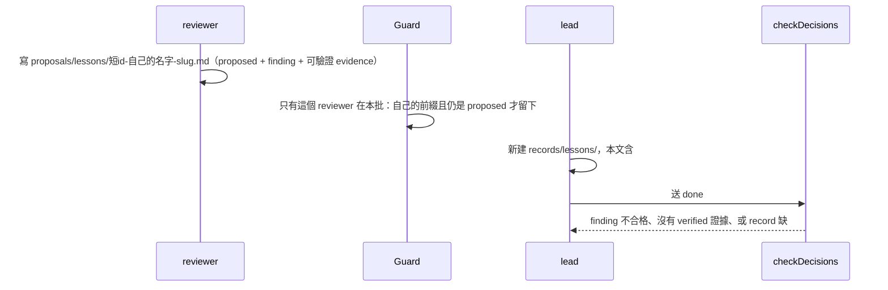

# 正常 run 的 reviewer 把 blocker／major finding 寫成 lesson 提案 實作計畫

> **For agentic workers:** REQUIRED SUB-SKILL: Use superpowers:subagent-driven-development (recommended) or superpowers:executing-plans to implement this plan task-by-task. Steps use checkbox (`- [ ]`) syntax for tracking.

**Goal:** 正常 run 裡，角色名以 `-reviewer` 結尾的 agent 可以把 severity 為 `blocker` 或 `major` 的 finding 寫成 lesson 提案；lead 收下時必須有可驗證證據，且正式 record 的本文抄下證據與 finding。

**Architecture:** 沿用 spec 30 的 `proposals/`，不開第二套目錄。`src/proposals.ts` 多認 `finding`，並在既有 `checkDecisions` 裡對「reviewer 提案」加嚴（`mailbox` 的 `done` 與 `proposals review` 的 post-check 都呼叫它，不另寫一套）。`mayPropose` 與 solo 的 guard 分支保持原樣。正常 run 的寫入權在 `writePolicy`／`readOnlyPolicy`，越權由 `Guard.checkProposals` 的新分支還原。Prompt 只加給 reviewer。

**Tech Stack:** TypeScript ESM、Node `fs`、Vitest、Biome。不新增依賴。

**來源:** [issue #177](https://github.com/gogogohuang/agent-lyceum/issues/177) 第一階段（D-1～D-6，驗收 1–10）。第二階段（`proposals from-pr`）不在本計畫。Persona 裡的 `class:` 文案另案，本計畫只檢查 `class` 是非空的一行。

## Global Constraints

- Node >=20，macOS 與 Linux；不新增依賴。
- 不改 solo proposal 的行為：`mayPropose`、solo 檔名 `<短id>-<slug>.md`、solo 的 guard 分支、tidy 的封存判準、既有 `test/proposals*.test.ts`、`test/guard-proposals.test.ts` 的既有案例、`test/mailbox-proposals.test.ts`、`test/memory-tidy-proposals.test.ts` 全部保持通過且不斷言被改寫來遷就新規則。
- 不讓 reviewer 寫 `records/`。不判斷 lesson 的因果是否正確。
- 程式、prompt、文件與測試不得寫死某個 agent 的名字。Reviewer 的判定是角色名（`roleOfName`）以 `-reviewer` 結尾。
- 沒有 reviewer 的專案，lead 與一般成員的 prompt 位元組與現在相同。
- 破壞使用者看得到的說明時，同步更新 `docs/commands.md` 與 `docs/commands.zh-TW.md`（中英標題結構一致），並通過 `npm run check:docs`。
- 每個 Task 一個 commit。每個 commit 只跑 `npm run typecheck` 與該 Task 點名的測試。完整 `npm test && npm run lint && npm run check:docs` 只在 Task 7 跑。
- 發版不在本計畫內。

## 本計畫採用的答案（issue 裡「實作前待確認」）

| # | 採用 |
|---|---|
| 1 | 兩種檔名並存。Solo 繼續 `<短id>-<slug>.md`。正常 run 的 reviewer 用 `<短id>-<agent>-<slug>.md`，`agent` 是 slot 名（instance 2 是 `cli-reviewer--2` 這種，不是角色名）。 |
| 2 | `finding.mail` 的存在性只在該提案的 run 目錄還在、且 `state.json` 的 `mail_layout` 是 `run` 時做。目錄已不在（`clear` 之後）就跳過，以 record 的 `## Evidence` 抄寫為準。 |
| 3 | 同一批裡 lead 與 reviewer（或兩個 reviewer）都在 `running` 時，提案區的改動記 `unattributed`、不還原。用測試證明，不另做歸屬推測。 |

## 審查後修正（第一輪，仍屬第一階段）

- `finding.mail` 是 reviewer 寫進自己 outbox 的檔名。路由之後該檔在 `outbox/<agent>/sent/`；held 的投遞在 `inbox/<agent>/pending/`。檢查這兩個目錄，以及原本的 inbox、read、outbox、rejected。Prompt 寫出完整 run id，並說明 mail 用 outbox 檔名。
- `run` 必須符合 `^\d{8}T\d+Z-[a-z0-9]+$`，否則 `run must be a run id`。Mail 目錄不把 `run` 字串接上 `runs/`：claimed id 的目錄還在就用它，否則用短 id 找到的那一個 run 目錄。完全找不到才 `skip`。多個且都不是 claimed id 時當 missing，不 skip。
- 正常 run 的 guard 對「別的 call，或在這個窗口裡開始的 run」的提案前綴 `continue`，不刪。這透過 `otherPrefixes`（`proposalForeignPrefixes`），不把那些 run 放進 `startedAfter`：後者會讓整批提案改動變成 unattributed，一般成員的寫入就不會被還原。
- `run must be a run id` 只套在 reviewer 擁有的檔（收下檢查與 doctor）。Solo 提案仍可寫短 id。
- `<role>--<k>-<slug>` 的擁有者是該 slot，只要 `role` 是 reviewer；slot 不在當下的 agent 表裡也算。Guard 用執行中 agent 的 `instance.role` 判斷，不要求 slot 已在建構 guard 時的 `project.agents`。
- Mail 以擁有者 outbox 的 `sent/` 為準（同名的 `rejected/`、別的 agent 的 outbox 不算第二筆）。沒有 outbox 副本時，才到 inbox（含 `read/`、`pending/`）找投遞後的檔名。
- 每次 `done` 仍對所有已收下的 reviewer 提案重跑證據、抄寫與 mail 檢查，跟 spec 30 的 `checkDecisions` 同一條路。之後 record 被改掉、commit 消失或 mail 被移走，會擋住下一次無關的 `done`，直到該提案被封存。這是取捨，不另做「只查這一輪改成 accepted 的檔」。

## 流程



## File Structure

| 檔案 | 責任 |
|---|---|
| `src/proposals.ts` | `finding` 解析、誰擁有這個檔名、reviewer 提案在 `accepted` 時的額外檢查、run 還在時的 mail 檢查 |
| `src/policy.ts` | reviewer 的 `allowDirs` 含提案區；`readOnlyPolicy` 也含，因為審查喚醒是 `read_only: true` |
| `src/guard.ts` | 正常 run 的提案區監看。Solo 分支不動 |
| `src/prompt.ts` | reviewer 的提案規則；lead 的待審提示只在有 reviewer 提案時多一句 `## Evidence` |
| `src/doctor.ts` | 待審的 reviewer 提案缺 `finding` 或 severity 不是 blocker／major 時警告 |
| `src/run-session.ts` | 有 reviewer 的正常 run 啟動時 `mkdir` 提案區 |
| `docs/commands.md`、`docs/commands.zh-TW.md` | 誰可以在正常 run 寫 lesson 提案 |

不改 `src/mailbox.ts`、`src/proposals-review.ts`、`src/memory-tidy.ts`：它們已經呼叫 `checkDecisions`。

## Interfaces

後面的 Task 都用這些名字與型別。

```ts
export interface Finding {
  mail: string;
  severity: string;
  className: string;
}

export function reviewerNames(project: ResolvedProject): string[];
export function proposalOwner(id: string, reviewerNames: readonly string[]): string | undefined;
export function isReviewer(project: ResolvedProject, agent: ResolvedAgent): boolean;
export type FindingMail = "skip" | "ok" | "missing" | "not-a-verdict-reply";
export function checkFindingMail(project: ResolvedProject, runId: string, mailBase: string): FindingMail;
```

- `Proposal` 新增選用欄位 `finding?: Finding` 與 `evidenceText: string[]`（YAML 裡每個 evidence 值的原文，抄寫檢查用）。沒有 `finding` 鍵的檔，`problems` 不因此增加。
- `reviewerNames`：`roleOfName(project.agents, name)` 以 `-reviewer` 結尾、且 `name !== project.lead` 的 slot 名。`project.solo` 時回空陣列（solo 不走這套）。
- `proposalOwner`：`id` 是檔名去掉 `.md`。符合 `<8 個小寫英數>-<reviewer 名>-<slug>` 才有擁有者；slug 是 `[a-z0-9-]+` 且至少一個字元。好幾個名字都對得上時取得最長者，所以 `cli-reviewer` 不會擁有 `cli-reviewer--2` 的檔。
- `isReviewer`：`reviewerNames(project).includes(agent.name)`。
- `checkDecisions` 的簽名不變。只在 `status === "accepted"` 且 `proposalOwner(p.id, reviewerNames(project))` 有值時加上下面的問題；`rejected` 仍只查 `reject_reason` 與 `decided`。
- `checkFindingMail` 不 import `mailbox.ts`（那裡已經 import `proposals.ts`）。自己讀 frontmatter。

Reviewer 提案被標 `accepted` 時，`checkDecisions` 額外拒絕的句子（測試用這些子字串）：

| 情況 | `problem` 含 |
|---|---|
| 沒有 `finding` | `accepted but finding is required` |
| `severity` 不是 `blocker` 或 `major` | `accepted but finding.severity must be blocker or major` |
| `class` 空的或超過一行 | `accepted but finding.class must be one non-empty line` |
| `mail` 空的、含 `/` 或 `..` | `accepted but finding.mail must be a file name` |
| run 還在且檔不存在 | `accepted but finding.mail was not found` |
| run 還在且不是帶 `verdict:` 的 reply | `accepted but finding.mail is not a reply with verdict` |
| `proposed_by` 不等於擁有者 | `accepted but proposed_by does not match the file name` |
| `checkEvidence(...).strength !== "verified"` | `accepted but evidence is not verified` |
| record 沒有獨立一行 `## Evidence` | `accepted but the record has no ## Evidence section` |
| record 本文缺某條 evidence 原文、或缺少 `mail`／`severity`／`class` 的值 | `accepted but the record does not copy the evidence and finding` |

`doctor` 對 `status` 為 `proposed` 或沒有可讀 status 的 reviewer 提案，用同一套 finding 規則產生 `warn`（缺 finding、severity 不是 blocker／major、class／mail 不合格）。Mail 不存在只在 `checkFindingMail` 不是 `"skip"` 時警告。`proposed` 不擋 `done`。

## 測試裡的 reviewer

`makeEnv()` 的全域 `team.yaml` 只有 `lead`、`fe-member`、`qa-member`。要一個 reviewer 時，把 `fe-member` 那一塊複製成 `cli-reviewer`（`runtime: claude-code`），並把 `home/agents/fe-member/AGENT.md` 複製到 `home/agents/cli-reviewer/AGENT.md`。第二個 reviewer 用 `qa-reviewer`，同樣複製。不要寫進 `project.yaml` 的 `agents:` 再指望它繼承：全域檔沒有這個名字就沒有 runtime。`qa-member` 不以 `-reviewer` 結尾，拿來當「一般成員」。

## Task 1：finding 與檔名擁有者

**Files:**

- Modify: `src/proposals.ts`
- Test: `test/proposals.test.ts`（只加案例，不改既有案例）

**Interfaces:**

- Consumes: 既有 `parseProposal`、`Proposal`、`checkEvidence`
- Produces: `Finding`、`reviewerNames`、`proposalOwner`、`evidenceText`、`finding`

- [ ] **Step 1: 寫會失敗的測試**

在 `test/proposals.test.ts` 加一個 `describe("reviewer finding (issue 177)")`。`reviewerNames` 用一個最小的假 `ResolvedProject` 即可（只要 `lead`、`solo`、`agents`）：

```ts
it("treats a role whose name ends with -reviewer as a reviewer, including instance 2, and never the lead", () => {
  const agents = {
    lead: { name: "lead" },
    "cli-reviewer": { name: "cli-reviewer" },
    "cli-reviewer--2": { name: "cli-reviewer--2", instance: { role: "cli-reviewer", k: 2 } },
    "fe-member": { name: "fe-member" },
  };
  const project = { lead: "lead", agents } as ResolvedProject;
  expect(reviewerNames(project)).toEqual(["cli-reviewer", "cli-reviewer--2"]);
  expect(reviewerNames({ ...project, solo: "run" })).toEqual([]);
});

it("gives the longer reviewer name the file when one name is a prefix of the other", () => {
  const names = ["cli-reviewer", "cli-reviewer--2"];
  expect(proposalOwner("ab12cd34-cli-reviewer-quote-yaml", names)).toBe("cli-reviewer");
  expect(proposalOwner("ab12cd34-cli-reviewer--2-quote-yaml", names)).toBe("cli-reviewer--2");
  expect(proposalOwner("ab12cd34-use-x", names)).toBeUndefined();
  expect(proposalOwner("ab12cd34-cli-reviewer", names)).toBeUndefined();
});

it("parses finding and keeps the evidence text, and a proposal without finding stays valid", () => {
  const withFinding = put(p, "lessons", "ab12cd34-cli-reviewer-quote-yaml", base({
    finding: "\n  mail: 20261128T010203456Z-cli-reviewer-aabbccdd.md\n  severity: major\n  class: quote-yaml\n",
  }, "  - path: src/a.ts:12 @ abc1234\n"));
  const parsed = parseProposal("lessons", withFinding);
  expect(parsed.problems).toEqual([]);
  expect(parsed.finding).toEqual({
    mail: "20261128T010203456Z-cli-reviewer-aabbccdd.md",
    severity: "major",
    className: "quote-yaml",
  });
  expect(parsed.evidenceText).toEqual(["src/a.ts:12 @ abc1234"]);

  const solo = put(p, "lessons", "ab12cd34-use-x", base({}, "  - mail: m1\n"));
  expect(parseProposal("lessons", solo).problems).toEqual([]);
  expect(parseProposal("lessons", solo).finding).toBeUndefined();
});

it("records a format problem when finding.severity is minor or nit, without rejecting a file that has no finding", () => {
  const minor = put(p, "lessons", "ab12cd34-cli-reviewer-nit", base({
    finding: "\n  mail: m.md\n  severity: minor\n  class: style\n",
  }, "  - commit: abc1234\n"));
  expect(parseProposal("lessons", minor).problems).toContain("finding.severity must be blocker or major");
});
```

`put`／`base` 沿用這個檔案既有的 helper。`finding` 鍵若 `base()` 還不支援，測試直接把 frontmatter 字串寫進檔案，不要改既有 helper 的預設值。

- [ ] **Step 2: 跑測試，確認新案例失敗**

Run: `npx vitest run test/proposals.test.ts -t "reviewer finding"`

Expected: FAIL，`reviewerNames` 尚未 export。

- [ ] **Step 3: 實作**

`reviewerNames` 與 `proposalOwner` 照 Interfaces 的定義。`parseProposal`：

- 每個成功的 evidence 值推進 `evidenceText`。
- `f.finding === undefined`：不設 `finding`，不加 problem。
- `f.finding` 不是 mapping：problem `finding must be a mapping`。
- 是 mapping：`mail`、`severity`、`class` 都要是非空的一行。`severity` 另外必須是 `blocker` 或 `major`，否則 problem `finding.severity must be blocker or major`（值仍放進 `finding.severity`，doctor 與 accept 才看得到 `minor`）。`class` 對應 `className`。
- `mail` 含 `/`、`\\` 或 `..`：problem `finding.mail must be a file name`。

既有沒有 `finding` 的提案，`problems` 與現在相同。

- [ ] **Step 4: 跑測試**

Run: `npm run typecheck && npx vitest run test/proposals.test.ts`

Expected: PASS（含既有案例）。

- [ ] **Step 5: Commit**

```bash
git add src/proposals.ts test/proposals.test.ts
git commit -m "$(cat <<'EOF'
feat: parse a reviewer finding on a lesson proposal

EOF
)"
```

## Task 2：收下時的 finding、證據與 ## Evidence

**Files:**

- Modify: `src/proposals.ts`（`checkDecisions`、新的 `checkFindingMail`）
- Test: `test/proposals-finding.test.ts`（新）

**Interfaces:**

- Consumes: Task 1 的 `proposalOwner`、`reviewerNames`、`Finding`、`evidenceText`；既有 `checkEvidence`、`checkDecisions`
- Produces: `checkFindingMail`；`checkDecisions` 對 reviewer 提案的額外 `problem`

- [ ] **Step 1: 寫會失敗的測試**

新檔。用 `makeEnv()`，並依「測試裡的 reviewer」登記 `cli-reviewer`。`bindRunProject(env.project(), runDir, "run")`，run id 用 `20261128T010203456Z-ab12cd34ef56ab12cd34ef56ab12cd34`，短 id `ab12cd34`。測試檔要 `import fs from "node:fs"`。Repo 用 `initGitRepo` 做一個 commit，evidence 指向那個 sha。

Mail 檔放在 `path.join(runDir, "mail", "inbox", lead, "20261128T010203456Z-cli-reviewer-aabbccdd.md")`，frontmatter 含 `type: reply` 與 `verdict: changes_requested`。

提案檔 `proposals/lessons/ab12cd34-cli-reviewer-quote-yaml.md`：`status: accepted`、`accepted_as: lessons/from-review`、`decided`、`proposed_by: cli-reviewer`、`run` 是這個 run id、`finding` 如上、evidence 是 `path: <檔> @ <sha>`。Record `records/lessons/from-review.md` 的 body 含一行 `## Evidence`，以及 evidence 原文、mail 檔名、`major`、`quote-yaml`。

案例（每個都呼叫 `checkDecisions(listProposals(p), p)`）：

1. 上面這份完整提案：回傳空陣列。
2. 刪掉 `finding`：含 `accepted but finding is required`。
3. `severity: minor` 與 `severity: nit`：含 `accepted but finding.severity must be blocker or major`。
4. 刪掉 mail 檔：含 `accepted but finding.mail was not found`。
5. mail 的 `type: task`，或沒有 `verdict`：含 `accepted but finding.mail is not a reply with verdict`。
6. 刪掉整個 run 目錄後再查：不因 mail 被拒（其他條件仍滿足時回傳空陣列）。
7. evidence 只剩 `mail: m1`：含 `accepted but evidence is not verified`。只有 `output:` 同樣。
8. record body 沒有 `## Evidence`：含 `accepted but the record has no ## Evidence section`。
9. 有標題但 body 沒有 evidence 原文：含 `accepted but the record does not copy the evidence and finding`。
10. 同一份提案改成 `status: rejected` 且有 `reject_reason` 與 `decided`、沒有 finding：回傳空陣列。
11. 既有形狀的 solo 檔 `ab12cd34-use-x.md`（只有 `mail:` evidence、沒有 finding、`accepted` 且 record 存在、沒有 `## Evidence`）：回傳空陣列。

- [ ] **Step 2: 跑測試，確認失敗**

Run: `npx vitest run test/proposals-finding.test.ts`

Expected: FAIL。完整提案仍被接受以外的條件拒絕，或 `checkFindingMail` 不存在。

- [ ] **Step 3: 實作**

`checkFindingMail(project, runId, mailBase)`：

- `mailBase` 含 `/`、`\\` 或 `..`：當 `"missing"` 不會發生在這裡；格式問題已由 parse 擋下。函式只收檔名。
- run 目錄是 `path.join(project.paths.runs, runId)`。沒有 `state.json`：`"skip"`。
- 讀 `state.json` 的 `mail_layout`，不是 `"run"`：`"skip"`。
- 在 `<runDir>/mail/inbox` 與 `<runDir>/mail/outbox` 底下每個 agent 目錄、以及它們的 `read/`、outbox 的 `rejected/`，找 basename 等於 `mailBase` 的一般檔（不跟隨 symlink）。零個：`"missing"`。多個：`"missing"`。
- 讀到的 frontmatter：`type` 省略或是 `reply`，且 `verdict` 是 `pass`、`changes_requested` 或 `fail`：`"ok"`。否則 `"not-a-verdict-reply"`。

`checkDecisions` 在既有 `accepted` 檢查之後，若 `proposalOwner` 有值，依 Interfaces 的表加 problem。`checkEvidence(p, project.dir).strength` 必須是 `"verified"`。Record 本文用 `accepted_as` 指向的檔（與 `recordExists` 同一路徑，含 `.archive/`）；讀取用 `readRegularFileNoFollow`，不跟隨 symlink。`## Evidence` 是 trim 之後恰好等於 `## Evidence` 的一行。抄寫是 `includes`：每條 `evidenceText`、`finding.mail`、`finding.severity`、`finding.className`。

- [ ] **Step 4: 跑測試**

Run: `npm run typecheck && npx vitest run test/proposals-finding.test.ts test/mailbox-proposals.test.ts test/proposals-review.test.ts`

Expected: PASS。後兩個是既有檔，確認 solo 的 `done` 與 review 沒被新規則牽連。

- [ ] **Step 5: Commit**

```bash
git add src/proposals.ts test/proposals-finding.test.ts
git commit -m "$(cat <<'EOF'
feat: reject a reviewer lesson that has no verified evidence

EOF
)"
```

## Task 3：doctor 警告

**Files:**

- Modify: `src/doctor.ts`（約 267–273 行，提案那段）
- Test: `test/proposals-status-doctor.test.ts`（只加案例）

**Interfaces:**

- Consumes: `proposalOwner`、`reviewerNames`、`Proposal.finding`、`Proposal.problems`
- Produces: 待審 reviewer 提案的 `warn`

- [ ] **Step 1: 寫會失敗的測試**

沿用這個檔的 doctor 呼叫方式。兩筆待審提案：

- `ab12cd34-cli-reviewer-no-finding.md` 沒有 `finding`：報告含 `finding is required`。
- `ab12cd34-cli-reviewer-nit.md` 的 `severity: nit`：報告含 `finding.severity must be blocker or major`。

沒有 `finding` 的 `ab12cd34-use-x.md` 不因 finding 被警告。

- [ ] **Step 2: 跑測試，確認失敗**

Run: `npx vitest run test/proposals-status-doctor.test.ts -t "finding"`

Expected: FAIL，doctor 沒有這兩句。

- [ ] **Step 3: 實作**

在既有提案迴圈裡，對 `proposalOwner` 有值且 status 是 `proposed` 或沒有 status 的提案：缺 `finding` 就 warn `finding is required`；`finding.severity` 不是 `blocker`／`major` 就 warn 那句。Parse 已經放進 `problems` 的句子，既有迴圈會印出來，不要印兩次。

- [ ] **Step 4: 跑測試**

Run: `npm run typecheck && npx vitest run test/proposals-status-doctor.test.ts`

Expected: PASS。

- [ ] **Step 5: Commit**

```bash
git add src/doctor.ts test/proposals-status-doctor.test.ts
git commit -m "$(cat <<'EOF'
feat: warn when a reviewer proposal has no blocker or major finding

EOF
)"
```

## Task 4：寫入權，含 read-only 審查

**Files:**

- Modify: `src/policy.ts`（`writePolicy` 約 213 行、`coordinatePolicy` 約 283 行、`readOnlyPolicy` 約 299 行）
- Modify: `src/proposals.ts` 若 `isReviewer` 放在這裡；`policy.ts` 可以呼叫它。不要從 `policy.ts` 產生對 `mailbox.ts` 的環。
- Test: `test/proposals-policy.test.ts`

**Interfaces:**

- Consumes: `isReviewer`
- Produces: reviewer 的 `allowDirs` 含 `proposalsDir`；`recordsDir` 仍在 `deny`

`readOnlyPolicy` 現在故意不含提案區（`src/policy.ts` 約 294–297 行的註解）。審查任務是 `read_only: true`（`src/run-session.ts` 約 830 行），不加的話 reviewer 在真正的審查喚醒裡寫不了提案。只把提案區加進 reviewer 的 `allowDirs`。Repo、records、`sandbox.write` 仍不在可寫集合。

- [ ] **Step 1: 寫會失敗的測試**

依「測試裡的 reviewer」登記 `cli-reviewer`。`test/proposals-policy.test.ts` 要加上 `import fs from "node:fs"`。

```ts
it("lets a reviewer write proposals on a normal run, including a read-only wake, and still denies the records", () => {
  env = makeEnv();
  const team = path.join(env.home, "team.yaml");
  fs.writeFileSync(team, fs.readFileSync(team, "utf8").replace("  fe-member:\n", "  cli-reviewer:\n    runtime: claude-code\n    agent_md: agents/cli-reviewer/AGENT.md\n    memory: { global: agents/cli-reviewer/memory }\n  fe-member:\n"));
  fs.mkdirSync(path.join(env.home, "agents", "cli-reviewer"), { recursive: true });
  fs.copyFileSync(path.join(env.home, "agents", "fe-member", "AGENT.md"), path.join(env.home, "agents", "cli-reviewer", "AGENT.md"));
  const p = env.project();
  const reviewer = p.agents["cli-reviewer"]!;
  for (const pol of [writePolicy(p, reviewer), readOnlyPolicy(p, reviewer)]) {
    expect(pol.allowDirs).toContain(proposalsDir(p));
    expect(pol.allowDirs).not.toContain(recordsDir(p));
    expect(pol.deny).toContain(recordsDir(p));
  }
  const member = p.agents["fe-member"]!;
  expect(writePolicy(p, member).allowDirs).not.toContain(proposalsDir(p));
  expect(readOnlyPolicy(p, member).allowDirs).not.toContain(proposalsDir(p));
  expect(mayPropose(p)).toBe(false);
});
```

- [ ] **Step 2: 跑測試，確認失敗**

Run: `npx vitest run test/proposals-policy.test.ts -t "read-only wake"`

Expected: FAIL，`readOnlyPolicy` 的 `allowDirs` 沒有提案區。

- [ ] **Step 3: 實作**

`writePolicy` 與 `coordinatePolicy` 裡 `isLead || mayPropose(project)` 改成 `isLead || mayPropose(project) || isReviewer(project, agent)`。`readOnlyPolicy` 的 `allowDirs` 在 reviewer 時加上 `proposalsDir(project)`。更新那個函式的註解：一般的 read-only 喚醒仍不含提案區；reviewer 例外，且仍不含 records。

`mayPropose` 的函式本體不改。

- [ ] **Step 4: 跑測試**

Run: `npm run typecheck && npx vitest run test/proposals-policy.test.ts`

Expected: PASS。

- [ ] **Step 5: Commit**

```bash
git add src/policy.ts src/proposals.ts test/proposals-policy.test.ts
git commit -m "$(cat <<'EOF'
feat: let a reviewer write lesson proposals during a read-only review

EOF
)"
```

## Task 5：正常 run 的 guard

**Files:**

- Modify: `src/guard.ts` 的 `checkProposals`（約 258 行）。`if (!this.project.solo) return;` 換成呼叫新的 private 方法，solo 的函式本體剪下、不改條件。
- Test: `test/guard-proposals.test.ts`（只加 `describe`，不改既有案例）

**Interfaces:**

- Consumes: `proposalOwner`、`reviewerNames`、`isReviewer`、`proposalStatusOf`、既有 `takeUnattributed`
- Produces: 正常 run 的還原／`unattributed` 行為

同一批分不出來時，推進既有的 `this.unattributed`，`otherRuns` 用空陣列，`agents` 用 `running` 的名字。不新增欄位。

對提案區裡每一個有變動的檔（`other.length > 0` 時沿用現況：全部 `unattributed`、不還原，然後才看下面這張表）：

| `running` 裡誰可以寫提案 | 動作 |
|---|---|
| 只有 lead | 刪除（之前有、現在沒有）還原並記違規。其他改動留下，含把檔改成 `accepted` |
| 只有一個 reviewer | 見下方「reviewer 規則」 |
| lead 與任何 reviewer，或 reviewer 多於一個，或 lead／reviewer 與一般成員同時在 | 該檔 `unattributed`，不還原 |
| 只有一般成員，或沒有人 | 還原或移除，並記違規 |

Reviewer 規則（相對提案區的路徑）：

- 必須是 `lessons/<id>.md`，且 `proposalOwner(id, reviewerNames)` 等於這個 reviewer，且 `id` 以本 run 的短 id 加 `-` 開頭。`decisions/`、`.archive/`、別人的前綴：違規。
- 刪除：違規。
- 基準的 status 已是 `accepted` 或 `rejected`：任何改動都違規。
- 新內容的 status 是 `accepted` 或 `rejected`：違規。
- frontmatter 壞掉或 status 拼錯：留下，交給 doctor。
- 基準不存在或是 `proposed`，結果仍是 `proposed`：留下。

Symlink 沿用 `realDirs`／`isLink`：`proposals/lessons` 換成 symlink 時不跟隨、不寫到區外。

- [ ] **Step 1: 寫會失敗的測試**

在 `test/guard-proposals.test.ts` 加 `describe("guard: a reviewer in an ordinary run (issue 177)")`。`cli-reviewer` 與 `qa-reviewer` 依「測試裡的 reviewer」登記。`bindRunProject(..., "run")`，短 id 與 Task 2 相同。每個案例 `new ProtectedGuard(p)` 之後改檔，再 `check([...])`。

1. 只有 `cli-reviewer` 在批內，新建 `proposals/lessons/ab12cd34-cli-reviewer-quote-yaml.md` 且 status 是 `proposed`：沒有違規，檔還在。
2. 只有這個 reviewer，寫 `records/lessons/x.md`：`action` 是 `removed`，檔不在。
3. 只有這個 reviewer：改 `ab12cd34-qa-reviewer-...`、把自己的檔寫成 `accepted`、刪掉自己的 `proposed` 檔、寫 `proposals/decisions/ab12cd34-cli-reviewer-x.md`：各自被還原或移除，且違規的 `suspects` 含這個 reviewer。
4. 缺 `finding` 但 status 仍是 `proposed` 的自家檔：不還原。
5. 只有 lead，把 (1) 的檔改成 `accepted`：沒有違規，檔是新內容。
6. 只有 lead，刪掉該檔：被還原，違規。
7. `check([lead, reviewer])` 在 lead 把檔改成 `accepted` 之後：`takeUnattributed()` 含這個檔，檔保持 `accepted`，違規清單沒有它。
8. `check([cli-reviewer, qa-reviewer])` 任一方改了提案：同樣是 `unattributed`，不還原。
9. 只有 `fe-member`，新建一個提案檔：被移除。
10. 既有的 solo `describe` 不改，本 Task 結束時整檔仍通過。

- [ ] **Step 2: 跑測試，確認新案例失敗**

Run: `npx vitest run test/guard-proposals.test.ts -t "ordinary run"`

Expected: FAIL。正常 run 的 `checkProposals` 直接 return，reviewer 寫的檔不會被判定，lead 的刪除也不會被還原。

- [ ] **Step 3: 實作**

把現在的 `checkProposals` 本體改名為 `checkSoloProposals`，條件與 regex 不變。新的 `checkProposals`：`this.project.solo` 時呼叫舊方法並 return；否則走上面的表。短 id 用既有 `ownPrefix()`。沒有短 id（沒綁 run）就 return。

- [ ] **Step 4: 跑測試**

Run: `npm run typecheck && npx vitest run test/guard-proposals.test.ts`

Expected: PASS，含既有 solo 案例。

- [ ] **Step 5: Commit**

```bash
git add src/guard.ts test/guard-proposals.test.ts
git commit -m "$(cat <<'EOF'
feat: guard lesson proposals written by a reviewer in a normal run

EOF
)"
```

## Task 6：prompt

**Files:**

- Modify: `src/prompt.ts`（`buildSystemPrompt` 約 313 行；`pendingProposalLines` 約 242 行）
- Test: `test/prompt-proposals.test.ts`

**Interfaces:**

- Consumes: `isReviewer`、`shortIdOf`、`proposalOwner`、`reviewerNames`
- Produces: reviewer 的 system prompt 段；lead 待審提示的附加句

沒有待審提案時，lead 與一般成員的 prompt 與現在位元組相同。`pendingProposalLines` 既有那句 “Put a short summary of the evidence in the record's body.” 保留。只有清單裡至少一筆 `proposalOwner` 有值時，才在那段末尾加一句：

`A proposal whose file name is a reviewer's must be copied into the record under a heading that is exactly \`## Evidence\`: the evidence entries and the finding's mail, severity and class, verbatim. Accept it only when one evidence entry is a path at a commit or a commit. The program rejects the done otherwise.`

Reviewer 的 system prompt 在團隊協議末尾加一段（英文，與 spec 30 的提案規則同一種語氣）。短 id 用 `shortIdOf(project.run.id)`；沒有 `project.run` 就不加這段。文字要包含這些字面值，測試用 `toContain`：

- `## Proposals`
- `` `${prefix}-${agent.name}-<slug>.md` ``，其中 `prefix` 是短 id
- `` `${dir}/lessons/` ``
- `severity` 為 `blocker` 或 `major`；`minor` 與 `nit` 不寫提案
- `finding` 的 `mail`、`severity`、`class`
- evidence 至少一筆 `path: ... @ <commit>` 或 `commit:`；`mail:` 與 `output:` 不算 verified
- 先寫觀察到的事實，再寫推測，並標明那是推測
- 不得把 `status` 設成 `accepted` 或 `rejected`，不得改別人的提案，不得刪除，不得寫 records

一般成員的 `buildSystemPrompt` 不含 `## Proposals`。

- [ ] **Step 1: 寫會失敗的測試**

`cli-reviewer` 的 `buildSystemPrompt` 含上面的字面短 id 與自己的檔名前綴。`fe-member` 的 prompt 與「加入這段之前」相同：先對沒有 reviewer 角色的專案取 `fe-member` 的 prompt 當對照，再断言有 reviewer 時 `fe-member` 的 prompt 仍等於那份對照。沒有任何提案時，lead 的 `buildUserPrompt` 與對照相等。有一筆 reviewer 提案待審時，lead 的 user prompt 含 `## Evidence`。只有 `ab12cd34-use-x` 這種待審提案時，不含那句新的 `## Evidence` 指示。

- [ ] **Step 2: 跑測試，確認失敗**

Run: `npx vitest run test/prompt-proposals.test.ts -t "reviewer"`

Expected: FAIL，reviewer 的 prompt 沒有 `## Proposals`。

- [ ] **Step 3: 實作**

`buildSystemPrompt` 在 `project.solo` 的提前 return 之後才加 reviewer 段，避免動到 solo prompt。`pendingProposalLines` 用 `proposalOwner` 判斷要不要附加那一句。

- [ ] **Step 4: 跑測試**

Run: `npm run typecheck && npx vitest run test/prompt-proposals.test.ts`

Expected: PASS。

- [ ] **Step 5: Commit**

```bash
git add src/prompt.ts test/prompt-proposals.test.ts
git commit -m "$(cat <<'EOF'
feat: tell a reviewer how to file a blocker or major finding

EOF
)"
```

## Task 7：目錄、文件、整批驗證

**Files:**

- Modify: `src/run-session.ts`（約 322 行，solo 的 `mkdir` 旁邊）
- Modify: `docs/commands.md`、`docs/commands.zh-TW.md` 的 `## proposals` 段
- Test: `test/proposals-policy.test.ts` 或既有 run 啟動測試，擇一已有「run 啟動會建目錄」覆蓋的檔；若沒有，在 `test/proposals-policy.test.ts` 旁不新增 run-session 整合，改為直接測一個從 `run-session` export 的小函式。不要為了 mkdir 把整個 run 跑起來。

**Interfaces:**

- Consumes: `reviewerNames`、`proposalsDir`
- Produces: `ensureReviewerProposalDir(project: ResolvedProject): void`

- [ ] **Step 1: 寫會失敗的測試**

`ensureReviewerProposalDir`：有 reviewer 且不是 solo 時，`proposalsDir` 被建立；沒有 reviewer 時不建立；`project.solo === "run"` 時也不在這個函式裡建立（solo 維持原本那行 `mkdir`）。

- [ ] **Step 2: 跑測試，確認失敗**

Run: `npx vitest run test/proposals-policy.test.ts -t "ensureReviewerProposalDir"`

Expected: FAIL，函式不存在。

- [ ] **Step 3: 實作並接上**

函式放 `src/policy.ts`，`run-session.ts` 在約 322 行 solo `mkdir` 的 `else` 呼叫它。文件兩份 `## proposals` 各加一小段：正常 run 裡角色名以 `-reviewer` 結尾的成員可以寫 `proposals/lessons/<短id>-<自己的名字>-<slug>.md`，且必須有 `finding`（`mail`、`severity: blocker|major`、`class`）與至少一筆可驗證證據；lead 收下時 record 要有 `## Evidence`。Solo 那段保留。中英標題結構不要拆開。

- [ ] **Step 4: 整批驗證**

Run: `npm run typecheck && npm test && npm run lint && npm run check:docs`

Expected: 全部通過。

- [ ] **Step 5: Commit**

```bash
git add src/policy.ts src/run-session.ts docs/commands.md docs/commands.zh-TW.md test/proposals-policy.test.ts
git commit -m "$(cat <<'EOF'
docs: describe reviewer lesson proposals in a normal run

EOF
)"
```

若 `src/` 與文件分成兩個 commit 更清楚，可以；目錄的程式與它的測試必須在同一個 commit。

## 驗收對照

| issue #177 驗收 | Task |
|---|---|
| 1. reviewer 為 major／blocker 寫自己前綴的 proposal：允許 | 5 的案例 1；4 的寫入權 |
| 2. reviewer 寫 `records/lessons/`：還原並記違規 | 5 的案例 2 |
| 3. 改別人前綴、寫 accepted／rejected、刪除：還原並記違規 | 5 的案例 3 |
| 4. severity 為 minor／nit 或缺 finding：doctor 警告，接受時被拒 | 2 的案例 2–3；3 |
| 5. mail 不存在或不是帶 verdict 的 reply：被拒 | 2 的案例 4–5 |
| 6. evidence 只有 mail／output：接受時被拒 | 2 的案例 7 |
| 7. record 缺 `## Evidence`：done 被拒 | 2 的案例 8（`done` 走同一個 `checkDecisions`） |
| 8. 同批 lead 與 reviewer 都改 proposal：unattributed，不還原 lead 的決定 | 5 的案例 7 |
| 9. lead 把 proposal 改 accepted：不還原 | 5 的案例 5 |
| 10. solo、records、tidy 既有測試不變 | 每個 Task 的回歸測試；Task 7 的整批 `npm test` |

## 不做

- 第二階段 `proposals from-pr`、`pr_comment:`、PR 留言候選。
- 一般成員（角色名不以 `-reviewer` 結尾）寫提案。
- Reviewer 寫 `proposals/decisions/`。
- 改 tidy 的 30 天規則。
- 改 persona 檔。
- 判斷 finding 的因果是否成立。
- 在 `status --json` 加欄位。
