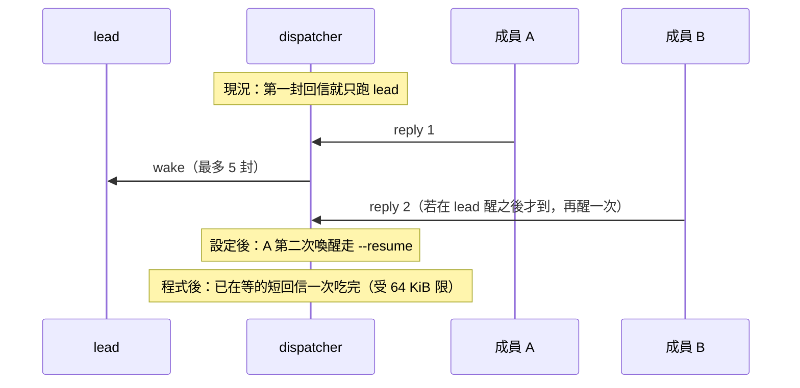

# 少喚醒、少寫 cache Implementation Plan

> **For agentic workers:** REQUIRED SUB-SKILL: Use superpowers:subagent-driven-development (recommended) or superpowers:executing-plans to implement this plan task-by-task. Steps use checkbox (`- [ ]`) syntax for tracking.

**Goal:** 用設定讓會被重叫的 Claude 成員續 session（少付 cache 寫入），並讓 lead 一次吃完已在等、且塞得進 64 KiB 的回信（少一次喚醒）。

**Architecture:** 5 小時用量對準的是輸出、未進 cache 的 input、以及成員每次新 session 的 cache **寫入**。lead 已 `resume: true`（cache 讀取）。本計畫不改 dispatcher 迴圈、不停駐行程。設定改使用者 home 的 yaml；程式只把 worktree `feat/lead-reply-batch` 的 `pickMessages` 搬進 `main`。

**Tech Stack:** 既有 TypeScript ESM、vitest、`~/agent-lyceum-config` 的 yaml。不新增依賴。

**依據：** #128（停駐不做）、`docs/evaluations/lead-parked-session.md`、`src/config.ts:275` 成員預設 `resume: false`、`src/prompt.ts:307` lead 最多 5 封。

## Global Constraints

- Node >=20，macOS／Linux。不新增依賴。
- 不改 `pickBatch`、不停駐 Claude 行程、不直接轉交作者回信、不設 token 金額預算、不硬性限制審查輪數。
- `max_rounds` 不當省 token 手段（到了就 `partial`）。
- 不從各 `project.yaml` 刪掉 QA 角色；小任務用 `run --agent`，不要改團隊名單。
- `code-explorer` 與所有 reviewer 維持新 session（獨立審查、搜尋要乾淨 context）。
- Codex 成員（`gpt-*`／`runtime: codex`）不在這次設 `resume`；續接語意與 Claude 不同。
- 設定檔在 `~/agent-lyceum-config`，不在這個 git repo。程式改動在使用者要求前不要 commit。
- 測試用 TDD；文件中英成對改。編號不要佔 spec 26（#121 另有用途；停駐那份狀態是不做）。

## 前置條件

- 這份計畫、`docs/evaluations/lead-parked-session.md` 和 `.worktrees/feat-lead-reply-batch` 目前都是未提交狀態，不在 `main`。開工前先把 worktree 的 `src/prompt.ts`、`test/pick-messages.test.ts` 差異存成 patch（或先 commit 該 worktree），避免 worktree 被清掉後來源消失。
- Task 1 改的是 `~/agent-lyceum-config`，那是另一個 git repo；改完在那邊 commit，才能回退。
- 在 agent 沙箱內跑 `npx vitest run` 時，有 6 個沙箱 process／watch 測試固定失敗（main 上也一樣），不算本計畫造成；要「全綠」須在沒有沙箱的機器上跑。

## 不做／延後

- lead 停駐同一行程（#128）。
- dispatcher 等回信到齊再叫 lead（要另開設計：延遲 vs 卡住）。
- 重試帶回失敗 outbox 草稿（spec 22）。
- 改 `WAKE_ECONOMY_SECTION` 正文（`main` 已有）。

## 檔案結構

- 修改 `~/agent-lyceum-config/team.yaml`：實作／驗證／除錯的 Claude 成員加 `resume: true`。
- 修改下列專案 yaml：只存在該專案、且是 Claude 實作者的成員加 `resume: true`（`projects/linego_official/project.yaml` 的 `frontend-2` 在實作時已不存在：config repo 工作樹裡有一筆未提交的刪除，不是本計畫造成，所以這裡不加 `resume`）。
- 修改 `src/prompt.ts`：`pickMessages` 對 lead 改為 64 KiB 內文預算，不再用 5 封上限。
- 修改 `test/pick-messages.test.ts`：lead 6 封短回信、4 封滿 16 KiB、部分截斷、成員仍最多 5。
- 修改 `docs/how-it-works.md`、`docs/how-it-works.zh-TW.md`、`docs/configuration.md`、`docs/configuration.zh-TW.md`。



---

### Task 1: 成員 `resume: true`（設定）

**Files:**
- Modify: `/Users/gogogohuang/agent-lyceum-config/team.yaml`
- Modify: `/Users/gogogohuang/agent-lyceum-config/projects/agent-lyceum/project.yaml`
- Modify: `/Users/gogogohuang/agent-lyceum-config/projects/linego_agent-hub/project.yaml`

**Interfaces:**
- Consumes: `src/config.ts` 的 `resume: resume ?? isLead`。yaml 寫了 `resume: true` 的成員，第二次喚醒帶 `--resume` session id。
- Produces: 下列 Claude 成員第二次以後走 cache 讀取，不再每次寫整包 system prompt。

**誰開、誰不開**

開（實作類，會被 `request-changes` 或重試再叫）：`architect`、`backend-architect`、`backend`、`frontend-architect`、`frontend`、`cicd-architect`、`cicd`、`qa`、`frontend-debugger`、`backend-debugger`、`ai-tools-engineer`、`shell-hooks-engineer`、`e2e-implementer`、`ui-ux`。

專案才有的：`cli-architect`、`node-engineer`、`docs-writer`、`runtime-debugger`、`agent-hub-dev`、`agent-hub-eval`。

先不開（沒有證據它們常被重叫，續接只會讓對話越積越長）：`driver-pm`、`data-analyst`、`report-reader`。之後有 run 紀錄顯示它們常被重叫再補。

不開：`tech-lead`／`report-lead`（已是 true）、所有 `*-reviewer`、`code-explorer`、任何 `model: gpt-*`。

代價與風險：

- 舊對話留在該成員 session。重大 `COMMON.md` 變更後若行為怪，把該成員改回 `resume: false` 或清 session。
- 續接的 Claude 成員可能沿用舊的 system prompt，所以之後加的 tier ladder、records 或 prompt 規則不一定會到它（`docs/configuration.md` 對 tier ladder 標示為未驗證）。
- **與 `model_tiers` 互相抵消：** 每個模型各有自己的 session，不會在另一個模型上續接（`docs/configuration.md`「Sessions」）。開了 `resume` 的成員，其後續任務若換了 tier，就開新 session，省下的 cache 寫入沒了。lead 對這些成員的修正任務盡量維持同一 tier。

- [ ] **Step 1: 在 `team.yaml` 每個「開」的 agent 區塊加一行**

每個區塊在 `runtime: claude-code` 之後插入 `resume: true`。範例（`backend`；其餘同形）：

```yaml
  backend:
    runtime: claude-code
    resume: true
    agent_md: agents/backend/AGENT.md
    memory: { global: agents/backend/memory }
```

`tech-lead`、`report-lead`、所有 `*-reviewer`、`code-explorer`、`code-explorer-reviewer` 不要加。

- [ ] **Step 2: 專案覆寫**

`projects/agent-lyceum/project.yaml` 的 `cli-architect`、`node-engineer`、`docs-writer`、`runtime-debugger` 各加 `resume: true`（與既有 `model`／`effort` 同層）。

`projects/linego_agent-hub/project.yaml` 的 `agent-hub-dev`、`agent-hub-eval` 加 `resume: true`。

其餘專案只繼承 `team.yaml`，不必重複寫。已寫 `model: gpt-*` 的 reviewer 不要加。

- [ ] **Step 3: 確認解析**

Run:

```bash
agent-lyceum doctor -p agent-lyceum
agent-lyceum doctor -p linego
```

Expected: exit 0（只證明設定能解析，不證明 `resume` 生效）。再用能顯示解析後 agent 設定的輸出確認，例如 `agent-lyceum status -p agent-lyceum --json`，對每個要開的成員確認 `resume` 為 `true`，對 `*-reviewer`、`code-explorer`、`gpt-*` 成員確認仍是 `false`。若 `status --json` 看不到這個欄位，改寫一個讀取 `loadProject` 結果的小測試。下一次該成員第二次喚醒的 attempt 參數應含 `--resume`（觀察，等真實 run）。

---

### Task 2: 操作習慣（設定／用法，不改程式）

**Files:** 無 repo 檔。這份計畫就是清單。

- [ ] **Step 1: 小任務不要開整隊**

四題都是否（不需要跨 runtime 審查、不能平行拆、不需要不同專長、單一 agent context 夠）時：

```bash
agent-lyceum run --agent node-engineer "…" -p agent-lyceum
```

不要為了一行修正把 `qa` 從 yaml 刪掉；yaml 留著給大任務。lead prompt 已要求小修正跳過 QA，它不聽時用 `--agent`。

- [ ] **Step 2: 用已有的階梯，不要再加模型**

`team.yaml` 已有 `model_tiers`。機械工作在 task 標 `tier: low`。`code-explorer` 已是 `claude-haiku-5-5`。不要把 `max_rounds` 設成省 token。

注意：對 Task 1 開了 `resume` 的成員，同一條工作線的後續任務不要中途換 tier，否則換模型就開新 session，續接省下的 cache 寫入會消失。

- [ ] **Step 3: 對過一次專案名單**

每個專案的 `agents:` 只留這個 repo 真的會用到的角色。少一個名字，lead 就少一個可派工對象。這步是刪「從未派過」的人，不是刪 QA。

---

### Task 3: lead 依 64 KiB 一次讀完已在等的回信

**Files:**
- Test: `test/pick-messages.test.ts`
- Modify: `src/prompt.ts`（`LEAD_BATCH_LIMIT` 註解、`pickMessages`）
- 參考（只讀、不要在這個 worktree 改）：`.worktrees/feat-lead-reply-batch/src/prompt.ts`、`.worktrees/feat-lead-reply-batch/test/pick-messages.test.ts`

**Interfaces:**
- Consumes: `cutUtf8`（`src/fs-util.ts`）、`MAIL_BODY_LIMIT`、`MAIL_BATCH_LIMIT`、`BATCHABLE`、`Message`。
- Produces: `pickMessages(project, agent, queue): Message[]` 與匯出常數 `LEAD_REPLY_CAP = 20`。lead：已在等的連續 `reply`／`failure`，最多 `LEAD_REPLY_CAP` 封，下一封若 `shownBodyBytes === 0` 則停、該封保持未讀。成員：仍最多 `LEAD_BATCH_LIMIT`、同一 thread。`task`／`ask` 仍一次一封。

- [ ] **Step 1: 改測試 helper，寫會失敗的三個 lead 案例**

把 `mail` 改成可選 body，並加上四個 it。先不要改 `src/prompt.ts`（`LEAD_REPLY_CAP` 還不存在，import 會先紅，這是預期的）。

```ts
import { LEAD_REPLY_CAP, MAIL_BODY_LIMIT, buildSystemPrompt, buildUserPrompt, pickMessages } from "../src/prompt.js";

function mail(n: number, type: MessageType, thread: string, body = "b"): Message {
  const file = `/x/2026010100000${n}-lead-m${n}.md`;
  return { meta: { id: `m${n}`, from: "lead", to: "fe-member", thread, type, subject: `s${n}`, created: "" }, body, file };
}

it("gives the lead every short reply that is already waiting", () => {
  env = makeEnv();
  const p = env.project();
  const queue = [1, 2, 3, 4, 5, 6].map((n) => mail(n, "reply", `t${n}`));
  expect(pickMessages(p, p.agents[p.lead]!, queue).map((m) => m.meta.id)).toEqual(["m1", "m2", "m3", "m4", "m5", "m6"]);
});

it("leaves a lead reply unread when none of its body fits the batch budget", () => {
  env = makeEnv();
  const p = env.project();
  const fat = "x".repeat(MAIL_BODY_LIMIT);
  const queue = [1, 2, 3, 4, 5].map((n) => mail(n, "reply", `t${n}`, fat));
  const got = pickMessages(p, p.agents[p.lead]!, queue);
  expect(got.map((m) => m.meta.id)).toEqual(["m1", "m2", "m3", "m4"]);
  const prompt = buildUserPrompt(p, p.agents[p.lead]!, queue, got.length);
  expect(prompt).toContain('from lead [reply] "s5"');
  expect(prompt).not.toContain("id: m5");
});

it("still hands the lead a reply that only partly fits, and keeps the one after it unread", () => {
  env = makeEnv();
  const p = env.project();
  const chunk = "x".repeat(15 * 1024);
  const queue = [1, 2, 3, 4, 5, 6].map((n) => mail(n, "reply", `t${n}`, chunk));
  expect(pickMessages(p, p.agents[p.lead]!, queue).map((m) => m.meta.id)).toEqual(["m1", "m2", "m3", "m4", "m5"]);
});

it("caps the lead at LEAD_REPLY_CAP waiting replies even when their bodies are tiny", () => {
  env = makeEnv();
  const p = env.project();
  const queue = Array.from({ length: LEAD_REPLY_CAP + 1 }, (_, i) => mail(i + 1, "reply", `t${i + 1}`));
  expect(pickMessages(p, p.agents[p.lead]!, queue)).toHaveLength(LEAD_REPLY_CAP);
});

it("keeps a member to five same-thread replies", () => {
  env = makeEnv();
  const p = env.project();
  const member = p.agents["fe-member"]!;
  const queue = [1, 2, 3, 4, 5, 6].map((n) => mail(n, "reply", "t1"));
  expect(pickMessages(p, member, queue).map((m) => m.meta.id)).toEqual(["m1", "m2", "m3", "m4", "m5"]);
});
```

既有三個 it（成員同 thread、task 不批次、lead 跨 thread）保留。

- [ ] **Step 2: 跑測試，確認新案例紅燈**

Run: `npx vitest run test/pick-messages.test.ts`

Expected: 「6 short replies」actual `["m1","m2","m3","m4","m5"]`；「4 fat」actual 含 `m5`；「cap」因 `LEAD_REPLY_CAP` 未匯出而失敗。

- [ ] **Step 3: 實作 `pickMessages`**

`src/prompt.ts` 把 `LEAD_BATCH_LIMIT` 註解改成「非 lead 同一 thread 上限；lead 改走 `MAIL_BATCH_LIMIT` 加 `LEAD_REPLY_CAP`」，在它旁邊新增匯出常數（header 不計入 64 KiB，很多極小的回信不加數量上限會讓 header 無限成長；20 是寬鬆值，不是調校過的數字）：

```ts
export const LEAD_REPLY_CAP = 20;
```

再把 `pickMessages` 換成：

```ts
/** Bytes of `body` this wake-up would actually show, using the same caps as the prompt. */
function shownBodyBytes(body: string, remaining: number): number {
  if (remaining <= 0) return 0;
  return cutUtf8(Buffer.from(body, "utf8"), Math.min(MAIL_BODY_LIMIT, remaining)).length;
}

/**
 * Messages one wake-up handles: the oldest one, or a run of `reply`/`failure` so the agent decides once.
 * The lead takes every such message that is already waiting and whose body still fits in `MAIL_BATCH_LIMIT`
 * (a later one that would show none of its body stays unread), at most `LEAD_REPLY_CAP`. Other agents take
 * at most `LEAD_BATCH_LIMIT` on the same thread.
 */
export function pickMessages(project: ResolvedProject, agent: ResolvedAgent, queue: Message[]): Message[] {
  const sorted = [...queue].sort((a, b) => path.basename(a.file).localeCompare(path.basename(b.file)));
  const first = sorted[0];
  if (!first || !BATCHABLE.has(first.meta.type)) return sorted.slice(0, 1);
  const isLead = agent.name === project.lead;
  const run: Message[] = [];
  let remaining = MAIL_BATCH_LIMIT;
  for (const m of sorted) {
    if (!BATCHABLE.has(m.meta.type)) break;
    if (run.length >= (isLead ? LEAD_REPLY_CAP : LEAD_BATCH_LIMIT)) break;
    if (!isLead && m.meta.thread !== first.meta.thread) break;
    const shown = isLead ? shownBodyBytes(m.body, remaining) : 0;
    if (isLead && Buffer.byteLength(m.body, "utf8") > 0 && shown === 0) break;
    run.push(m);
    if (isLead) remaining -= shown;
  }
  return run;
}
```

檔案頂端若尚未 import `cutUtf8`，從 `./fs-util.js` 沿用既有 import。

- [ ] **Step 4: 測試通過**

Run: `npx vitest run test/pick-messages.test.ts`

Expected: 全部 PASS。

Run: `npx vitest run`

Expected: 全綠（worktree 上一次是 1391）。

Run: `npx biome lint src/prompt.ts test/pick-messages.test.ts`

Expected: 乾淨。

---

### Task 4: 文件與 Saving tokens 那句

**Files:**
- Modify: `docs/how-it-works.md` 第 3 點
- Modify: `docs/how-it-works.zh-TW.md` 第 3 點
- Modify: `docs/configuration.md`「Saving tokens」那段（第 199 行附近，`batched (up to 5, …)` 的句子）
- Modify: `docs/configuration.zh-TW.md` 對應段（第 201 行附近，`最多 5 封` 的句子）
- Modify: `docs/analysis-agent-context-and-mail.md` 第 69 行（「最多 5 封（`LEAD_BATCH_LIMIT`）」）；這份是繁中分析文件，只改 lead 的部分，並註明程式行號可能已變動

- [ ] **Step 1: how-it-works**

英文把「the lead instead takes a run of up to 5 `reply`/`failure` messages at once」改成：

`the lead instead takes every waiting reply/failure whose body still fits in the 64 KiB body budget (at most 20), leaving unread a later message that would show none of its body`

中文把「lead 例外，會一次拿到連續最多 5 封 `reply`/`failure`」（原計畫漏了「連續」，以 `docs/how-it-works.zh-TW.md` 實際字串為準）改成：

`lead 例外，會一次拿到所有已在等待、內文還放得進 64 KiB 預算的 reply/failure（最多 20 封），下一封若一點內文都放不進就留著未讀`

- [ ] **Step 2: configuration Saving tokens**

英文「batched (up to 5, `LEAD_BATCH_LIMIT` …)」改成 worktree 那句：waiting together 交給 lead，以 `MAIL_BATCH_LIMIT` 64 KiB 為限且最多 `LEAD_REPLY_CAP`（20）封；放不進的留未讀；其他 agent 仍最多 5（`LEAD_BATCH_LIMIT`）。

中文對應改 `docs/configuration.zh-TW.md` 同一段；`docs/analysis-agent-context-and-mail.md` 第 69 行同步改成 lead 依 64 KiB 預算、最多 20 封，非 lead 維持 5 封。

不要改「dispatcher 不會延後喚醒」那句：單獨抵達的回信仍會叫 lead。

- [ ] **Step 3: 文件檢查**

Run: `node scripts/check-docs.mjs`

Expected: `docs ok`。

---

## 完成後怎麼看有沒有效

- 同一 run 裡同一位 `resume: true` 的成員，第二次 attempt 的 CLI 參數有 `--resume`，且 `cache_creation_input_tokens` 明顯小於第一次（觀察，未在本計畫自動驗）。
- lead 信箱一次出現 6 封短 `reply` 時只醒一次（Task 3 的單元測試已鎖這個）。
- 單獨抵達的第 1 封回信仍會立刻叫 lead（行為不變）。
