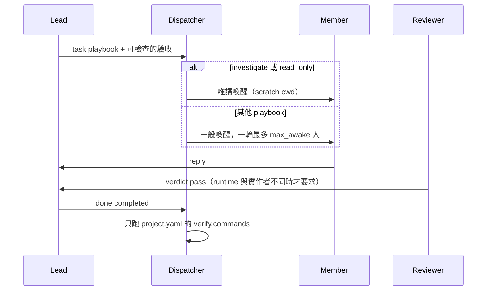

# pstack 嚴謹度 Implementation Plan

> **For agentic workers:** REQUIRED SUB-SKILL: Use superpowers:subagent-driven-development (recommended) or superpowers:executing-plans to implement this plan task-by-task. Steps use checkbox (`- [ ]`) syntax for tracking.

**Goal:** 讓 lead 的任務信帶上四種 playbook、可執行的驗收、調查時的唯讀喚醒，並讓 `completed` 在有跨 runtime 隊友時必須有別人的 `verdict: pass`、在使用者打開 `bind_task` 時只跑 `project.yaml` 裡已寫的驗證指令；同時限制一輪同時醒來的人數，並把重複的 lesson 升格成 `doctor` 檢查。

**Architecture:** 新行為都是純函式（playbook、驗收、喚醒上限、跨 runtime、任務綁定、lesson guard），mailbox 與 `RunSession` 只負責呼叫。`playbook` 與 `read_only` 留在送達的信件 frontmatter，讓收件人看得到。唯讀喚醒用新的 `readOnlyPolicy` 填進 `WakeInput.policy`（不要傳 `writePolicy`）：adapter 改在 scratch 目錄啟動，可寫範圍只剩 memory、outbox 與自己的 agent 目錄，repo 在 `readDirs`。dispatcher 絕不執行任務檔或信件裡的字串。

**Tech Stack:** TypeScript、NodeNext、vitest、既有 zod `.strict()`、既有 `format-rejections` 計數。

**Spec:** 本檔就是規格，不另開 `docs/specs/` 編號。



## Global Constraints

- 不執行 `task.md`、follow-up 或任何信件裡的 shell。spec 27 D-02：驗證指令只能來自使用者寫的 `project.yaml` `verify.commands`。那些指令在 agent sandbox 外、以使用者權限執行。
- `verify.bind_task` 預設 `false`。沒寫時，`completed` 的驗證行為與現在相同。
- `bind_task: true` 只做比對：任務 `## Verification` 裡「整行就是一個 backtick 指令」，或 fenced code block（開頭可以是 ` ``` ` 或 ` ```lang `）的每一行，必須等於某條 `verify.commands[].run`。對不上不退信、不增加 `done_rejections`。run 開始時記一筆 note，`completed` 直接帶 `gateFailure` 降成 `partial`。lead 改不了 `project.yaml`，也改不了 `task.md`。
- `dispatcher.max_awake` 選填，整數 1–16；沒寫時 worktree 模式一輪最多醒 8 個非 lead。lead 仍單獨醒。`shared` 模式仍一次一個人。沒寫時 `doctor --resolved` 不列出這個鍵（與 `max_instances` 相同）。
- `playbook` 只接受 `investigate`、`fix`、`feature`、`refactor`。只有 lead 的 `task` 生效。其他寄件者、其他 type、或 lead 的非 task：欄位不寫進送達的信，並記一筆 ignored。非法值整封退回，不送達。
- `playbook: investigate` 等同 `read_only: true`。`read_only` 只接受 YAML boolean；規則與 `playbook` 相同（只有 lead 的 `task` 生效，否則忽略）。
- `feature` 的 task 還要有 `## Shape`。缺了走與缺標題相同的退回：同一寄件者＋type＋subject＋原因，最多 `MAX_FORMAT_REJECTIONS`（2）次，之後送達並在正文前加警告。
- 驗收條件過弱也走格式退回，但計數鍵要分開（`:acceptance`、`:shape`），不要和缺標題共用次數。`None` 不是可檢查的驗收，包在 backtick 裡也一樣：整條去掉清單符號與 backtick 之後若只剩佔位字，不可檢查。`acceptanceIssues` 的句子不要塞進 `missingSections`，否則 `formatWarning` 會把它包成 `` `## …` ``。
- 契約退回與跨 runtime 閘門共用 `done_rejections`（`MAX_DONE_REJECTIONS` 是 2）。次數用完時仍要重算閘門，把原因放進 `resolveDoneOutcome` 的 `gateFailure`，`completed` 降成 `partial`。`bind_task` 對不上不走這個次數。`resolveDoneOutcome` 只看 `contract.missing` 與 `verifyFailure`，閘門原因不在 `missing` 裡，不傳 `gateFailure` 就會維持 `completed`。`blocked` 維持 `blocked`，note 把閘門原因接在後面。降成 `partial` 不開 PR。
- 一次喚醒裡，每一封正在處理的信都是唯讀任務時，這次喚醒才唯讀。混進一封可寫的信，這次可寫。
- 唯讀 policy 是 `readOnlyPolicy`，不是 `writePolicy`。`writePolicy` 含 `ws.gitDir`、`sandbox.write`、`can_edit_agent_md` 的檔案。`invokeWithSandboxChecks` 在 `input.policy` 存在時會跳過 `sandboxRefusal`，所以 `readOnlyPolicy` 不得複製 `sandbox.write`。
- 唯讀旗標寫進 `ClaimRecord.read_only`（選填，舊 claim 沒有這個欄位就不是唯讀）。同一筆 claim 在 invoke 前記下 `head`（選填，該 worktree 當時的 `HEAD` sha）。`recover()` 看到 `read_only` 不得呼叫 `integrateMember`。`rec.ready` 與 `rec.abandoned` 的唯讀 claim，有 `head` 就要還原到那一筆。記憶體裡的 Map 在 crash 後不存在。
- 唯讀喚醒若改到成員自己的 worktree：不要 `integrateMember`。還原只用 `agentGit`（先 `assertNoNestedRepos`），`reset --hard` 的目標是 claim 上記下的 `head`，不是當下的 `HEAD`。禁止 `dirtyPaths` 與裸的 `git`。禁止對 `project.dir` 做 reset 或 clean。上一筆 claim 用 `previousClaim` 從 `mail/claims/` 讀，不看記憶體裡的 Map。上一筆存在且 `read_only` 不是 `true`、工作區已髒時，先 `commitWorkspace` 留下那些改動，再把 `head` 設成這個新 commit。沒有上一筆、或上一筆已是唯讀時，不要 commit。這次喚醒裡新做的 commit 與未提交檔案都回到那個 `head`。`agent.name === project.lead` 時這次喚醒不當成唯讀：不設 policy、不記 `head`、不 discard。`spaces[lead]` 就是 `leadSpace`，對它 discard 會清掉整次 run。這些 git 呼叫若丟錯，在 `runWithFallback` 外面會讓約 `run-session.ts:1503` 的 `Promise.all` 整個 reject：接住後 `abandonClaim`、`refuseMember`，不要 invoke。
- `shared` 模式沒有成員 worktree：只靠 `readOnlyPolicy` 的 scratch cwd，不還原使用者的工作目錄。claude-code 或 codex 在 `osSandboxAvailable()` 為假時，以及任何 cursor 喚醒，記 `read-only-unenforced`。
- 跨 runtime 閘門看 `mode`。worktree 的實作者只有 `state.implementers`（真的整合了檔案的人）。shared 才把本段裡處理過非唯讀 `task` 的非 lead（`state.wakes`）算進去。runtime 用該次 wake 的 `WakeRecord.runtime`（有 fallback 才有），否則用設定裡的 runtime。候選人是 runtime 不在實作者集合裡的非 lead。`verdict: pass` 必須來自候選人。lead 的 pass 不算。閘門只在 `project.agents` 每個 runtime 都相同時關閉。候選人是空的時不關閉，兩種情況都算：另一個 runtime 的人也是實作者，或另一個 runtime 只有 lead 自己。沒有合格的 pass 就退回，次數用完降成 `partial`。用既有的 `state.reviews` 與 `verdict:` frontmatter，不另解析 `## Verdict`。shared 模式的審查 task 必須 `read_only: true`，否則那個 QA 會變成實作者；閘門仍開著，只是沒有人能給 pass。
- 本段 = `at` >= 最後一次 `state.reopened[].at`；沒有 reopen 則整次 run 都算。這只切 `reviews` 與 shared 的 wake。`state.implementers` 沒有 `at`，是整次 run 累積的，reopen 前寫過程式的人在新的一段仍算實作者。`WakeRecord` 加選填 `read_only?: true`。
- lesson 的 `seen` 與 `guard` 是選填。沒寫的舊檔仍有效。`seen` 要是正整數；`guard` 只能是 `verify-configured`。寫錯讓該筆 record `invalid`（doctor 已會警告），不要讓整個 records 目錄讀取失敗。
- `seen >= 2` 且沒有 `guard`：doctor warning。`seen >= 2` 且 `guard: verify-configured` 且 `verify.commands` 是空的：doctor error。兩筆 effective-active lesson 的 title 正規化後相同：doctor warning。doctor 不執行 lesson 裡的任何字串，也不改 `verify.commands`。
- 不升 `STATE_SCHEMA_VERSION`。信件與 state 的新欄位都是選填。
- 舊版二進位會因 `project.yaml` 出現 `dispatcher.max_awake` 或 `verify.bind_task` 而拒絕載入（"Unrecognized key"）。降版說明要寫進中英文 README。lesson frontmatter 的新鍵舊版會忽略。降版前不要留下有未完成唯讀喚醒的 run：舊版 `recover()` 看到 `output_ready` 會照樣 `integrateMember`。
- 程式風格：雙引號、分號、相對 import 加 `.js`。`npm run lint` 須過。
- 英文與繁中文件成對更新。
- **Commit：** 僅在使用者明確要求執行本 plan 且要求 commit 時，才在 task 末 commit。
- 不 bump version、不寫 changelog，除非使用者另要求。
- 不做 arena、不等 CI、不禁止 lead commit、不把 22 個 pstack playbook 放進 dispatcher。

## File Structure

| File | Responsibility |
| --- | --- |
| `src/playbook.ts` | playbook／read_only 的判定、`feature` 額外標題、這次喚醒是否唯讀 |
| `src/policy.ts` | `readOnlyPolicy`：唯讀喚醒的寫入範圍 |
| `src/adapters/cursor.ts` | policy 喚醒把 `readDirs` 加進 `--add-dir` |
| `src/format.ts` | `acceptanceIssues`：驗收條目是否可檢查；`formatWarning` 可另收驗收原因 |
| `src/run-outcome.ts` | `resolveDoneOutcome` 的第五個參數 `gateFailure` |
| `src/message-store.ts` | `ClaimRecord.read_only`、`head`；`previousClaim` 從磁碟讀上一筆 |
| `src/wake-cap.ts` | `capBatch`：一輪最多醒幾個人 |
| `src/review-gate.ts` | `crossRuntimeBlock`：`completed` 缺跨 runtime 的 `pass` 時回傳原因 |
| `src/task-bind.ts` | 從使用者任務抽出要綁定的指令字串，並算出哪些沒出現在 `verify.commands` |
| `src/records.ts` | 讀 `seen`、`guard`；正規化 title |
| `src/doctor.ts` | 呼叫 lesson guard，不執行 shell |
| `src/schema.ts` | `max_awake`、`bind_task` |
| `src/mailbox.ts` | 退回、忽略、寫進送達的 frontmatter；重複信比對含 playbook 與 read_only |
| `src/prompt.ts` | lead／成員的 playbook 說明；改寫「可跳過 QA」 |
| `src/scaffold.ts` | 新專案的 lead／成員 persona 補一行 |
| `src/run-session.ts` | 唯讀 policy、claim 旗標、跳過整合、退回 `done`、follow-up 驗收文字 |
| `src/worktree.ts` | `workspaceDirty`、`discardWorkspaceEdits`，只用 `agentGit` |
| `test/helpers.ts`、`test/fixtures/runtime/fake-claude.mjs` | 任務驗收從 `None` 改成可檢查的條目 |
| `test/fixtures/instances/`、`test/instances-compat.test.ts` | prompt 與 mail 變了就重生快照。`checkAll` 在 UPDATE 時把 a／e／f 的 lead wake prompt 去掉 `PARALLEL_SECTION(4)` 再寫回。改掉「成員 prompt 不得變」的註解 |
| `docs/how-it-works.md` 與 `.zh-TW.md`、`docs/upgrading-run-v2.md` | 喚醒上限、唯讀、`completed` 閘門 |
| `docs/configuration.md` 與 `.zh-TW.md` | `max_awake`、`bind_task`、lesson `seen`／`guard` |
| `docs/task-template.md` 與 `docs/task-template.zh-TW.md` | 驗收與驗證的寫法 |
| `README.md` 與 `README.zh-TW.md` | 降版：新鍵 |

---

### Task 1: playbook、唯讀與驗收的純函式

**Files:**
- Create: `src/playbook.ts`
- Modify: `src/format.ts`（`acceptanceIssues`，放在 `sectionText` 之後）
- Test: `test/playbook.test.ts`、`test/format-acceptance.test.ts`

**Interfaces:**
- Consumes: 無
- Produces:

```ts
export const PLAYBOOKS = ["investigate", "fix", "feature", "refactor"] as const;
export type Playbook = (typeof PLAYBOOKS)[number];

export type PlaybookFlag =
  | "absent"
  | "invalid"
  | Playbook
  | { ignored: "not-lead" | "not-a-task" };

export function playbookFlag(i: { value: unknown; senderIsLead: boolean; type: string }): PlaybookFlag

export type ReadOnlyFlag = "absent" | "invalid" | boolean | { ignored: "not-lead" | "not-a-task" };

export function readOnlyFlag(i: { value: unknown; senderIsLead: boolean; type: string }): ReadOnlyFlag

/** investigate 為真；明確的 true 為真；false、absent、ignored 為假。 */
export function effectiveReadOnly(playbook: Playbook | undefined, flag: ReadOnlyFlag): boolean

/** feature 要多一個 Shape；其他 playbook 沒有額外標題。 */
export function extraSections(playbook: Playbook | undefined): string[]

export function wakeIsReadOnly(messages: readonly { type: string; playbook?: string; read_only?: unknown }[]): boolean

export function acceptanceIssues(body: string): string[]
```

`acceptanceIssues` 用 `sectionText(body, "Acceptance criteria")`。沒有這個標題時回 `[]`（缺標題仍由 `missingSections` 管）。有標題時，條目是非空、且不是標題的行。先判斷佔位字：去掉行首的清單符號（`-`、`*`、數字加句點），再刪掉 backtick、把空白收成一個，拉丁字母轉小寫。整條等於 `none`、`as stated`、`as stated in the goal`、`同上`、`如目標`、`待補`、`tbd`、`todo` 時不可檢查。這個判斷在 backtick 配對之前，所以 `` - `None` `` 也不算。其餘條目算可檢查，若它含有一對 backtick（內容至少 1 個字元），或含有 `\S+\.[A-Za-z0-9]+`（檔名或測試名）。去掉可檢查條目之後，若一個都不剩，回 `["Acceptance criteria has no checkable item (a \`command\`, a file or a test name)"]`。

`wakeIsReadOnly`：`messages` 至少一封，且每一封 `type === "task"`，且 `effectiveReadOnly(isPlaybook(playbook) ? playbook : undefined, read_only === true ? true : read_only === false ? false : "absent")` 為真。空陣列回 `false`。

- [ ] **Step 1: 寫失敗測試**

`test/playbook.test.ts`：

```ts
import { describe, expect, it } from "vitest";
import { effectiveReadOnly, extraSections, playbookFlag, readOnlyFlag, wakeIsReadOnly } from "../src/playbook.js";

describe("playbookFlag", () => {
  it("accepts a lead task", () => {
    expect(playbookFlag({ value: "investigate", senderIsLead: true, type: "task" })).toBe("investigate");
  });
  it("rejects an unknown name", () => {
    expect(playbookFlag({ value: "bug", senderIsLead: true, type: "task" })).toBe("invalid");
  });
  it("ignores a member and a non-task", () => {
    expect(playbookFlag({ value: "fix", senderIsLead: false, type: "task" })).toEqual({ ignored: "not-lead" });
    expect(playbookFlag({ value: "fix", senderIsLead: true, type: "reply" })).toEqual({ ignored: "not-a-task" });
  });
  it("treats a missing field as absent", () => {
    expect(playbookFlag({ value: undefined, senderIsLead: true, type: "task" })).toBe("absent");
  });
});

describe("read only", () => {
  it("investigate forces read only", () => {
    expect(effectiveReadOnly("investigate", "absent")).toBe(true);
    expect(effectiveReadOnly("fix", true)).toBe(true);
    expect(effectiveReadOnly("fix", false)).toBe(false);
  });
  it("a wake is read only only when every handled message is a read-only task", () => {
    expect(wakeIsReadOnly([{ type: "task", playbook: "investigate" }])).toBe(true);
    expect(wakeIsReadOnly([{ type: "task", playbook: "investigate" }, { type: "task", playbook: "fix" }])).toBe(false);
    expect(wakeIsReadOnly([])).toBe(false);
  });
});

describe("extraSections", () => {
  it("feature asks for Shape", () => {
    expect(extraSections("feature")).toEqual(["Shape"]);
    expect(extraSections("fix")).toEqual([]);
    expect(extraSections(undefined)).toEqual([]);
  });
});
```

`test/format-acceptance.test.ts`：

```ts
import { describe, expect, it } from "vitest";
import { acceptanceIssues } from "../src/format.js";

describe("acceptanceIssues", () => {
  it("accepts a command, a file or a test name", () => {
    expect(acceptanceIssues("## Acceptance criteria\n- `npm test` passes")).toEqual([]);
    expect(acceptanceIssues("## Acceptance criteria\n- src/format.ts exports acceptanceIssues")).toEqual([]);
  });
  it("rejects a placeholder and a missing check", () => {
    expect(acceptanceIssues("## Acceptance criteria\n- as stated in the goal")).toEqual([
      "Acceptance criteria has no checkable item (a `command`, a file or a test name)",
    ]);
    expect(acceptanceIssues("## Acceptance criteria\nNone")).toEqual([
      "Acceptance criteria has no checkable item (a `command`, a file or a test name)",
    ]);
    expect(acceptanceIssues("## Acceptance criteria\n- `None`")).toEqual([
      "Acceptance criteria has no checkable item (a `command`, a file or a test name)",
    ]);
  });
  it("does not complain when the heading itself is absent", () => {
    expect(acceptanceIssues("## Goal\nship it")).toEqual([]);
  });
});
```

- [ ] **Step 2: 跑測試確認失敗**

Run: `npx vitest run test/playbook.test.ts test/format-acceptance.test.ts`

Expected: FAIL，`playbook.js` 不存在，`acceptanceIssues` 未匯出。

- [ ] **Step 3: 實作**

`src/playbook.ts` 照上面的簽名實作。`playbookFlag` 的順序與 `tierFlag` 相同：空值（`undefined`、`null`、`""`）為 `absent`；非 lead 為 `{ ignored: "not-lead" }`；值不是四個名字之一為 `invalid`；type 不是 `task` 為 `{ ignored: "not-a-task" }`；否則回傳該 playbook。`readOnlyFlag`：空值 `absent`；非 lead `{ ignored: "not-lead" }`；不是 boolean 為 `invalid`（YAML 的 `true`／`false` 才算，字串 `"true"` 是 invalid）；type 不是 `task` 為 `{ ignored: "not-a-task" }`；否則回傳該 boolean。

`src/format.ts` 匯出 `acceptanceIssues`。可檢查的判斷不要把整段正文的 backtick 算進去，只看單一條目。佔位字先比對：`` - `None` `` 含有 backtick，但仍要退回。

- [ ] **Step 4: 跑測試確認通過**

Run: `npx vitest run test/playbook.test.ts test/format-acceptance.test.ts`

Expected: PASS

---

### Task 2: 信件路由採用 playbook、read_only 與驗收

**Files:**
- Modify: `src/mailbox.ts`（`MessageMeta`、`DeliverInput`、`deliveredMeta`、`deliver`、`routeOutboxes`、`earlierDuplicate`）
- Test: `test/mailbox.test.ts`（加案例；沿用該檔已有的專案夾具與 `routeOutboxes` 呼叫方式）

**Interfaces:**
- Consumes: Task 1 的 `playbookFlag`、`readOnlyFlag`、`effectiveReadOnly`、`extraSections`、`acceptanceIssues`；既有 `missingSections`、`formatRejectionKey`、`MAX_FORMAT_REJECTIONS`
- Produces: 送達的 `MessageMeta` 多兩個選填欄位

```ts
playbook?: Playbook;
read_only?: true;
```

只有生效的值才寫入。`read_only: false` 與 absent 都不寫。ignored 不寫。

`RouteResult` 加：

```ts
playbookIgnored: { from: string; id: string; to: string; subject: string; type: string; reason: "not-lead" | "not-a-task" }[];
readOnlyIgnored: { from: string; id: string; to: string; subject: string; type: string; reason: "not-lead" | "not-a-task" }[];
```

與 `tierIgnored` 同一形狀。`run-session` 在 Task 4 才記 log；本 task 只要 `routeOutboxes` 填好這兩個陣列。

重複信：`earlierDuplicate` 多比 `playbook`（沒有視為沒有）與 `read_only`（只有 `true` 為真）。同一正文、不同 playbook 或不同唯讀，不算重複。

退回文案：

- playbook 非法：`` `playbook must be investigate, fix, feature or refactor, not ${JSON.stringify(value)}. Write it on a new task, or leave the line out.` ``
- read_only 非法：`` `read_only must be true or false (YAML boolean), not ${JSON.stringify(value)}.` ``
- 缺 `## Shape`：與缺標題相同，項目是 `Shape`，計數鍵 `` `${formatRejectionKey(sender, type, subject)}:shape` ``。
- 驗收過弱：正文列出 `acceptanceIssues` 的句子，不要包成 `` `## …` ``。計數鍵是 `` `${formatRejectionKey(sender, type, subject)}:acceptance` ``。
- 兩種原因同時發生時各算各的次數。任一尚未用完就整封退回，正文列出全部原因。兩種都用完才送達。`formatWarning` 加一個選填的驗收句子陣列：標題仍只放標題名（含 `Shape`），驗收句子另起，不要進 `res.warnings[].missing`。
- 退回只在 `project.run?.layout === "run"`。legacy layout 第一次就送達並加警告，與現在缺標題的行為相同（`mailbox.ts` 裡 `layout === "run"` 那個分支）。

`feature` 以外不要因為沒有 `## Shape` 而退回。

既有會被退回的任務正文，在這個 task 一起改掉，否則 run layout 的舊測試會失敗：

- `test/helpers.ts` 的 `TASK_BODY`：`## Acceptance criteria` 改成 `- \`npm test\``。`REPLY_BODY` 的 `None` 維持。
- `test/fixtures/runtime/fake-claude.mjs` 預設 task 正文的驗收同樣改成 `- \`npm test\``。
- `test/dispatcher.test.ts` 裡那封 task 的 `## Acceptance criteria\nNone` 改成 `- \`npm test\``。同檔約第 103 行的 digest 現在是 `[{ label: "目標", lines: ["Build the login form"] }]`。`digestLines` 會丟掉 `None`，但會留下去掉 backtick 之後的 `npm test`（`src/format.ts` 約 151、179 行，標籤是 `驗收`）。預期改成 `[{ label: "目標", lines: ["Build the login form"] }, { label: "驗收", lines: ["npm test"] }]`。
- `test/run-mailbox.test.ts` 與 `test/shared-memory.test.ts` 對 `TASK_BODY` 做 `.replace("None", subject)`。改完後第一個 `None` 不再是驗收。若測試要求 subject 出現在驗收，改成明確替換 `` `- \`npm test\`` ``。
- 全庫搜尋經 outbox 路由的 task 正文，不只 `None`。下面三處的驗收在 run layout 也會被退回，要改成 `` `- \`npm test\`` ``：`test/run-lifecycle.test.ts` 的 `works`、`test/solo-run.test.ts` 的 `x`、`test/run-ask.test.ts` 的 `a`。reply 的 `None` 不要改。
- `src/mailbox.ts` 缺標題的退回句現在寫 `write \`None\` where a section is empty`。改成：空的區段寫 `None`，但 `## Acceptance criteria` 不行，那一節要有 backtick 指令、檔名或測試名。包成 `` `None` `` 也會被退回。

`TASK_BODY` 會被 `withSections` 用進 `test/instances-compat.test.ts` 的 task 正文，所以 `*.mail.txt` 會立刻對不上。本 task 不要跑 `instances-compat`，也不要手改那些快照。Task 3 重生時一起寫回。

- [ ] **Step 1: 寫失敗測試**

在 `test/mailbox.test.ts` 加四個案例（用該檔既有的 lead／成員與 outbox 寫法）：

1. lead 的 task，`playbook: investigate`，標題齊、驗收是 `` `- \`npm test\`` ``：送達的 frontmatter 有 `playbook: investigate` 與 `read_only: true`。
2. lead 的 task，`playbook: bug`：不送達，退回原因含 `investigate, fix, feature or refactor`。
3. 成員的 task，`playbook: fix`：送達的 frontmatter 沒有 `playbook`，`playbookIgnored[0].reason` 是 `not-lead`。
4. 用 `mailbox.test.ts` 裡 `runProject("run")` 那組夾具。lead 的 task，`playbook: feature`，驗收是 `- as stated in the goal`，沒有 `## Shape`：第一次不送達；把同一封再送兩次（每次都是新檔、同一 subject）後第三次送達，正文以 `[agent-lyceum] Format warning` 開頭，警告裡有 `## Shape`，也有 `no checkable item`，且沒有 `` `## Acceptance criteria has no `` 這種包法。
5. 同一個專案改成 legacy layout：第一封就送達，正文以警告開頭，不進 `rejected/`。

- [ ] **Step 2: 跑測試確認失敗**

Run: `npx vitest run test/mailbox.test.ts`

Expected: FAIL，新案例斷言失敗。上面列出的 fixture 改完之後，既有案例要通過。

- [ ] **Step 3: 實作**

在 `routeOutboxes` 裡，`tier` 判定之後、`missingSections` 之前，計算 `playbookFlag` 與 `readOnlyFlag`。`invalid` 走既有 `reject(...)`。ignored 記進新陣列，且不要寫進 `DeliverInput`。

生效的 playbook 傳進 `deliver`／`deliverOnce`。`effectiveReadOnly(playbook, flag)` 為真時傳 `read_only: true`。

`deliveredMeta` 與 `deliver` 的 `MessageMeta` 帶上這兩個選填欄位。

缺標題與缺 `Shape` 放在同一個標題陣列。`acceptanceIssues` 放在另一個陣列，不要 concat 進標題陣列。退回計數分成三個鍵：既有的缺標題鍵、`:shape`、`:acceptance`。只有「這次新增的原因」才消耗對應的鍵。某個原因的次數已滿，該原因不再擋送達，改列入 warning。legacy layout 不計數、不退回，直接加警告。

- [ ] **Step 4: 跑測試確認通過**

Run: `npx vitest run`

Expected: 只有 `test/instances-compat.test.ts` 失敗（`TASK_BODY` 讓 mail 快照對不上，prompt 快照留到 Task 3）。其他檔案 PASS，含 `test/dispatcher.test.ts`。不要手改 instances 快照。

---

### Task 3: prompt、persona、follow-up 驗收

**Files:**
- Modify: `src/prompt.ts`（`WAKE_ECONOMY_SECTION` 先不動第三點，本 task 只加 playbook；第三點在 Task 6 改）
- Modify: `src/scaffold.ts`（`PERSONAS.lead`、`PERSONAS["fe-member"]`、`PERSONAS["qa-member"]`）
- Modify: `src/run-session.ts`（follow-up 那封 task 的 `## Acceptance criteria`）
- Modify: `test/instances-compat.test.ts`（`checkAll` 的 UPDATE 分支；檔頭註解）
- Test: `test/prompt-mail-limit.test.ts` 或既有 prompt 測試裡加一段；`test/run-session` 若 follow-up 已有測試就加斷言，否則只測純字串函式

**Interfaces:**
- Consumes: `PLAYBOOKS`
- Produces: `export const PLAYBOOK_SECTION: readonly string[]`

`PLAYBOOK_SECTION` 全文：

```ts
export const PLAYBOOK_SECTION = [
  "## Playbooks",
  "On a new task you send, set `playbook` to one of: investigate, fix, feature, refactor. Leave it out only when none of these fits.",
  "- `investigate`: read only. Do not change product code. The dispatcher runs that wake without a writable repo. The reply puts the answer under Open items and `None` under Changes.",
  "- `fix`: the acceptance criteria names the check that fails before the fix and passes after.",
  "- `feature`: add a `## Shape` heading that names the data type or module boundary before any edit.",
  "- `refactor`: behavior stays the same. The acceptance criteria names the check that already passes and must still pass.",
  "`playbook: investigate` is read-only even without `read_only: true`. You may also set `read_only: true` on a task that must not edit the repo. A teammate cannot set either field.",
  "A review task, including asking QA to check someone else's work, is `read_only: true`. In a shared-folder run that is what keeps the reviewer from being treated as an author.",
];
```

lead 的 system prompt 在 `WAKE_ECONOMY_SECTION` 之前插入 `PLAYBOOK_SECTION`。成員的 system prompt 在 `## Message format` 之前插入同一段，讓他們讀得懂收到的 frontmatter。

`src/prompt.ts` 裡「write `None` under a heading if there is nothing to say」改成：除了 `## Acceptance criteria` 以外可以寫 `None`；驗收要有 backtick 指令、檔名或測試名，寫 `None` 會被退回。

`test/instances-compat.test.ts` 第 19–22 行規定成員的 system prompt 不得變，只有 lead 可以加固定後綴。本 task 會改到每一個 agent 的 system prompt，也會改到 mail（Task 2 的 `TASK_BODY` 經 `withSections` 進快照），所以那條註解要改寫：快照是為 playbook 文字與可檢查驗收重生的。

`checkAll` 在 `leadSuffix` 且檔名是 `*.wake.lead-<n>.system.txt` 時（約 175–179 行，情境 a、e、f）現在只拿舊檔加上 `PARALLEL_SECTION(4)` 來比，`UPDATE_INSTANCES_FIXTURES` 也不寫回。要改成：環境變數打開時，若擷取到的文字以 `\n\n${PARALLEL_SECTION(4)}` 結尾，去掉這段後綴再交給 `fixture()` 寫回；後綴對不上就不要寫，讓斷言失敗。比對時仍是「快照檔加上同一段後綴」。情境 (b) 沒有這個後綴，繼續走 `fixture()`，寫進去的 lead wake 必須和去掉後綴之後的那份相同。不要手改快照。

實作後跑：

```bash
UPDATE_INSTANCES_FIXTURES=1 npx vitest run test/instances-compat.test.ts
```

預期 diff：

- 每份 `*.system.txt` 多出 `## Playbooks`。
- lead 的 system prompt 多 persona 那句 `Set playbook on every task`。fe-member 多 `do not edit the repo`。qa-member 不再有 `## Verdict`，改成 frontmatter 的 `verdict:`。
- `*.mail.txt` 的驗收從 `None` 變成 `` - `npm test` ``。`a/e/f.state.json` 與 `a/e/f.status.json` 的摘要多出驗收 `npm test`（`digestOf` 丟掉 `None`、留下這行）。不該出現 format warning。出現的話是 `withSections` 用的 `TASK_BODY` 仍是 `None`，先回到 Task 2。instances-compat 的 task 正文不走 `fake-claude.mjs`。
- a、e、f 的 `*.wake.lead-*.system.txt` 檔案裡不要含 `PARALLEL_SECTION(4)`。那段仍由測試在比對時接回去。

`scaffold.ts` 的 lead persona 在平行任務那行之後加：`Set \`playbook\` on every task you send (investigate, fix, feature, or refactor) and make every acceptance item a command, a file or a test name.`

fe-member 加：`When the task says \`playbook: investigate\` or \`read_only: true\`, do not edit the repo.`

qa-member：刪掉「add a `## Verdict` section」。改成：`When you review, set \`verdict: pass\`, \`changes_requested\` or \`fail\` in the reply frontmatter. The dispatcher reads that line, not a \`## Verdict\` heading. A pass means you ran the check. On a read-only wake the repo is not writable, so a check that must write caches or build output cannot be the proof; say so under Open items.`

follow-up 那封 task 是 `deliver()` 直接投進 inbox（`run-session.ts` 組 body 的地方），不經過 `routeOutboxes`。把驗收那一行抽成 `run-session.ts` 匯出的函式，兩處用同一份：

```ts
export function followupAcceptance(taskFile: string): string {
  return `- The follow-up's Goal is met, and every item under Acceptance criteria in \`${taskFile}\` still holds.`;
}
```

`deliver()` 的正文改用這個函式。它含 `.md` 路徑，`acceptanceIssues` 會放行。測試 import 這個函式，不要只在測試檔重寫一行。

`init` 只在檔案不存在時寫 persona。本 task 不回寫使用者家目錄裡已經存在的 `AGENT.md`。文件要寫：既有團隊要自己補這三行，或刪掉該 `AGENT.md` 後再 `init`。

- [ ] **Step 1: 寫失敗測試**

新檔 `test/prompt-playbook.test.ts`：

```ts
import { describe, expect, it } from "vitest";
import { PLAYBOOK_SECTION } from "../src/prompt.js";
import { acceptanceIssues } from "../src/format.js";
import { followupAcceptance } from "../src/run-session.js";

describe("playbook prompt", () => {
  it("names the four playbooks", () => {
    expect(PLAYBOOK_SECTION.join("\n")).toContain("investigate, fix, feature, refactor");
  });
  it("the follow-up acceptance line that deliver() uses is checkable", () => {
    const line = followupAcceptance("/tmp/run/task.md");
    expect(acceptanceIssues(`## Acceptance criteria\n${line}`)).toEqual([]);
  });
});
```

`buildSystemPrompt` 需要整個 `ResolvedProject`。本 task 不組那個夾具；prompt 是否含 `## Playbooks` 交給 `instances-compat` 的快照。

- [ ] **Step 2: 跑測試確認失敗**

Run: `npx vitest run test/prompt-playbook.test.ts`

Expected: FAIL，`PLAYBOOK_SECTION` 未匯出。

- [ ] **Step 3: 實作**

照 Interfaces 改 prompt、scaffold、run-session，並改 `checkAll`。不要改 `WAKE_ECONOMY_SECTION` 的第三點（Task 6）。

- [ ] **Step 4: 跑測試確認通過**

Run: `npx vitest run test/prompt-playbook.test.ts test/format-acceptance.test.ts test/instances-compat.test.ts`

Expected: PASS。`instances-compat` 在快照重生之後才會過。

---

### Task 4: 唯讀喚醒

**Files:**
- Modify: `src/policy.ts`（新增 `readOnlyPolicy`）
- Modify: `src/worktree.ts`（`workspaceDirty`、`discardWorkspaceEdits`）
- Modify: `src/message-store.ts`（`ClaimRecord.read_only`、`ClaimRecord.head`；`setClaimReadOnly`；`previousClaim`）
- Modify: `src/run-session.ts`（`base.policy`、settle、`recover`、invoke 前的 git 錯誤）
- Modify: `src/adapters/cursor.ts`（`input.policy` 時把 `readDirs` 放進 `--add-dir`）
- Test: `test/policy-readonly.test.ts`、`test/worktree.test.ts`、`test/adapters-cursor.test.ts`、`test/readonly-wake.test.ts`

**Interfaces:**
- Consumes: `writePolicy`、`repoDirFor`、`memoryDirs`、`outboxDir`、`agentGit`、`assertNoNestedRepos`、`commitWorkspace`
- Produces:

```ts
export function readOnlyPolicy(project: ResolvedProject, agent: ResolvedAgent): WritePolicy

export function workspaceDirty(ws: AgentWorkspace): boolean

/** 把這個 worktree 還原到 `head`（claim 上記下的 sha），並清掉未追蹤檔。呼叫者必須傳成員的 AgentWorkspace，不能傳 project.dir。 */
export function discardWorkspaceEdits(ws: AgentWorkspace, head: string): void

export function setClaimReadOnly(runDir: string, claimId: string, head?: string): void

/** 同一 agent、id 不是 exceptId、created 最大的那筆。沒有則 undefined。 */
export function previousClaim(runDir: string, agent: string, exceptId: string): ClaimRecord | undefined
```

`readOnlyPolicy` 照 `memory-tidy.ts` 裡 maintenance wake 的組法，但可寫更窄：

```ts
export function readOnlyPolicy(project: ResolvedProject, agent: ResolvedAgent): WritePolicy {
  const normal = writePolicy(project, agent);
  const ownDir = projectAgentDir(project, agent.name);
  const grantOwnDir = ownAgentDirAllowed(project, agent);
  const allowDirs = [
    ...memoryDirs(agent),
    ...(project.solo === "call" ? [] : [outboxDir(project, agent.name)]),
    ...(grantOwnDir ? [ownDir] : []),
  ];
  return {
    allowDirs,
    allowFiles: [],
    readDirs: [...new Set([repoDirFor(project, agent.name), ...normal.readDirs, ...normal.allowDirs.filter((d) => !allowDirs.includes(d))])],
    deny: normal.deny,
  };
}
```

不得包含 `ws.gitDir`、`agent.sandbox.write`、records、proposals、`can_edit_agent_md` 的檔案。函式上方註明：`invokeWithSandboxChecks` 看到 `input.policy` 會跳過 `sandboxRefusal`，所以這裡不能把 `sandbox.write` 抄進來。不要改那行 short-circuit。claude 與 codex 已把 `readDirs` 放進可讀範圍，不要改它們。cursor 要改：`src/adapters/cursor.ts` 的 `addDirs` 只含 `allowDirs` 與 allowFiles 的目錄，`--workspace` 在 policy 喚醒時是 scratch。`input.policy` 存在時把 `pol.readDirs` 也放進 `addDirs`，讓 repo 讀得到。補一個斷言：policy 喚醒的 cursor 參數含 `--add-dir` 與 `repoDirFor` 的路徑。

`workspaceDirty`：`assertNoNestedRepos(ws)` 之後 `agentGit(ws, ["status", "--porcelain", "-z", "--untracked-files=all"])`，輸出非空即為真。不要呼叫 `dirtyPaths`。

`discardWorkspaceEdits`：`assertNoNestedRepos(ws)`，然後 `agentGit(ws, ["reset", "--hard", head])`，再 `agentGit(ws, ["clean", "-fd"])`。`head` 是呼叫者剛用 `agentGit` 讀到的 sha，不要拿信件裡的字串來當它。失敗把 git 的錯誤丟出。`reset --hard HEAD` 不夠：這次喚醒裡新做的 commit 會變成新的 `HEAD`，之後仍可能被整合。

`ClaimRecord` 加選填 `read_only?: true` 與 `head?: string`。`setClaimReadOnly` 讀檔、寫回 `{ ...claim, read_only: true, ...(head ? { head } : {}) }`。`validClaim` 會把多餘欄位留在物件上（它回傳 `v as ClaimRecord`），不要把它改成會拒絕未知欄位。

`previousClaim` 讀 `mail/claims/*.json`（目錄不存在就回 `undefined`）。同一 `agent`、`id !== exceptId`，挑 `created` 最大的一筆。JSON 壞掉的檔跳過。不要讀 `wake()` 的 `claims` Map：約 `run-session.ts:695` 的 `claims.set` 會蓋掉上一筆，settle 約 1125 行的 `claims.delete` 會把它刪掉。

`wake()` 在組 `base` 之前先算唯讀。現在的 `const base = { project, agent, workDir, ... }`（約 `run-session.ts:699`）是推斷型別，事後指定 `base.policy` 會是 TS2339。宣告時就帶上：

```ts
const readOnly = agent.name !== project.lead && wakeIsReadOnly(unread.map((m) => ({ type: m.meta.type, playbook: m.meta.playbook, read_only: m.meta.read_only })));
const base = {
  project: aproject,
  agent,
  workDir,
  workspace: spaces[agent.name],
  systemPrompt: buildSystemPrompt(aproject, agent),
  userPrompt: buildUserPrompt(project, agent, queue, unread.length, (state.reopened?.length ?? 0) > 0, this.userTask()),
  timeoutSec: cfg.wake_timeout_sec,
  policy: readOnly ? readOnlyPolicy(aproject, agent) : undefined,
};
```

`claimMessages` 之後處理唯讀。後面 `invokeWithSandboxChecks` 展開的就是這個 `base`。不要另做一個沒人傳進 `invoke` 的物件。

下面這段包在 try 裡，從判斷上一筆到 `setClaimReadOnly`。`commitWorkspace`、`workspaceDirty`、`rev-parse` 都可能被 `assertNoNestedRepos` 擋下。錯誤發生在 `runWithFallback` 外面，會讓約 1503 行的 `Promise.all` 整個 reject。catch：`abandonClaim(runDir, claim.id)`、`claims.delete(agent.name)`、`this.refuseMember(agent, message)`，回 `{ ok: false, error: message }`，不要 invoke。catch 裡不要再呼叫 discard。

唯讀、有 `ws`、`workspaceDirty(ws)`：`previousClaim(runDir, agent.name, claim.id)` 存在且 `read_only !== true` 時，才在 invoke 前 `commitWorkspace(ws, "agent-lyceum: keep edits from before a read-only wake")`。沒有上一筆、或上一筆已是唯讀時，不要 commit。那些髒檔留到 settle 清掉。

然後若 `readOnly`：有 `ws` 時 `head` 是 `agentGit(ws, ["rev-parse", "HEAD"])`（上面的 `commitWorkspace` 若有跑，這就是那個新 commit），呼叫 `setClaimReadOnly(runDir, claim.id, head)`。沒有 `ws` 就 `setClaimReadOnly(runDir, claim.id)`。

`wake()` 在失敗或取消、呼叫 `abandonClaim`（約 `run-session.ts:901`）之前：若這筆 claim 是唯讀、有 `ws`、且 claim 上有 `head`，先 `discardWorkspaceEdits(ws, head)`。這樣取消或失敗留下的改動，包含這次喚醒裡新做的 commit，不會在下一次「先 commit」時被提交，也不會被後來的 `integrateMember` 帶進 repo。

這次喚醒寫進 `state.wakes` 時，唯讀則加 `read_only: true`。`WakeRecord` 加這個選填欄位。`run-store` 的 wakes schema 是 `z.array(z.any())`，舊 state 仍可讀。

`settle()` 現在是 `if (ws && results[i]?.ok) this.integrateMember(...)`。不要讀 `claims` Map 裡的物件：`setClaimReadOnly` 不會改那份記憶體複本。用 `loadClaim(runDir, claimId)`。`read_only === true` 時：

- 有 `ws` 且 claim 上有 `head`：先看還原前是否 `workspaceDirty(ws)`，或 `agentGit(ws, ["rev-parse", "HEAD"])` 不等於 `head`。然後一律 `discardWorkspaceEdits(ws, head)`，不要因為工作區看起來乾淨就跳過。乾淨的 worktree 也可能比 `head` 多一個這次喚醒做的 commit。上面任一為真才記 log `read-only-reverted`，並 `deliver` 一封 `failure` 給 lead，主旨 `Read-only wake edited <agent>`。正文說明這次喚醒的 commit 與未提交檔案已清掉，喚醒當下記下的那一筆還在，信箱仍會投遞。不要 `integrateMember`。`discardWorkspaceEdits` 丟出的錯誤要接住，呼叫既有的 `refuseMember(agent, message)`，不要讓 settle 中斷整個 run。`integrateMember` 自己有 try/catch（約 `run-session.ts:966`），這條路徑要對齊。
- 沒有 `ws`：不碰 `project.dir`。
- 有沒有 `ws` 都記：runtime 是 `cursor`，或 runtime 是 `claude-code`／`codex` 且 `osSandboxAvailable()` 為假，記 log `read-only-unenforced`。worktree 上的 cursor 喚醒事後仍會 discard，但喚醒當下擋不住寫入，所以也要記。這與全局約束的「任何 cursor 喚醒」是同一條。

`recover()` 在 `wsMode === "worktree"` 時，`rec.ready` 與 `rec.abandoned` 都要看。`loadClaim` 的 `read_only === true` 且有 `head`、也找得到 `existingAgentWorkspace`：`discardWorkspaceEdits(ws, head)`，然後不要 `integrateMember`。`abandoned` 的信仍維持現在的說法（訊息留著未讀、之後重做）；清掉的是 worktree，避免下一次可寫喚醒把崩潰留下的 commit 提交並整合。沒有 `read_only` 的舊 claim 維持現在的整合。`discard` 丟出的錯誤走 `refuseMember`，不要中斷 `recover`。

`routeOutboxes` 回傳的 `playbookIgnored`／`readOnlyIgnored` 各記一筆 log：`playbook_ignored`、`read_only_ignored`，欄位與現有 `tier_ignored` 相同（`from`、`id`、`to`、`subject`、`type`、`reason`）。同一寄件者與原因只在 run notes 寫一次，比照 `tier_ignored` 的 note。

- [ ] **Step 1: 寫失敗測試**

`test/policy-readonly.test.ts` 自己組夾具。`test/worktree.test.ts` 沒有共用的 `ws`，`ResolvedAgent.sandbox` 是選填，不要寫還沒定義的 `ws` 或 `agent.sandbox.write[0]`。`SandboxAllowances` 的 `write`、`network`、`localBinding`、`unixSockets` 都要有。

```ts
it("readOnlyPolicy keeps the repo readable and drops sandbox.write and the git dir", () => {
  env = makeEnv();
  initGitRepo(env.repo);
  const project = env.project();
  const ws = prepareAgentWorkspace(project, "run-1", "fe-member", snapshotBase(project, "run-1", 1));
  const scratch = fs.mkdtempSync(path.join(os.tmpdir(), "sandbox-write-"));
  const agent = {
    ...project.agents["fe-member"]!,
    sandbox: { write: [scratch], network: [], localBinding: false, unixSockets: [] },
  };
  const pol = readOnlyPolicy({ ...project, workspaces: { "fe-member": ws } }, agent);
  expect(pol.allowFiles).toEqual([]);
  expect(pol.allowDirs.some((d) => d === ws.gitDir)).toBe(false);
  expect(pol.allowDirs.some((d) => d === scratch)).toBe(false);
  expect(pol.readDirs).toContain(repoDirFor(project, agent.name));
  expect(pol.allowDirs).toContain(outboxDir(project, agent.name));
});
```

`test/worktree.test.ts` 的 import 加上 `agentGit` 與 `discardWorkspaceEdits`（`snapshotBase`、`prepareAgentWorkspace`、`commitWorkspace` 已經有）：

```ts
it("discardWorkspaceEdits returns the worktree to the recorded head", () => {
  env = makeEnv();
  initGitRepo(env.repo);
  const project = env.project();
  const ws = prepareAgentWorkspace(project, "run-1", "fe-member", snapshotBase(project, "run-1", 1));
  fs.writeFileSync(path.join(ws.dir, "kept.txt"), "kept\n");
  commitWorkspace(ws, "keep");
  const head = agentGit(ws, ["rev-parse", "HEAD"]);
  fs.writeFileSync(path.join(ws.dir, "during.txt"), "during\n");
  commitWorkspace(ws, "during the wake");
  fs.writeFileSync(path.join(ws.dir, "untracked.txt"), "nope\n");
  discardWorkspaceEdits(ws, head);
  expect(agentGit(ws, ["rev-parse", "HEAD"])).toBe(head);
  expect(fs.existsSync(path.join(ws.dir, "during.txt"))).toBe(false);
  expect(fs.existsSync(path.join(ws.dir, "untracked.txt"))).toBe(false);
  expect(fs.readFileSync(path.join(ws.dir, "kept.txt"), "utf8")).toBe("kept\n");
});
```

不要對 `project.dir` 呼叫 `discardWorkspaceEdits`。

`test/adapters-cursor.test.ts` 在既有 `--add-dir` 案例旁加一則。`policy` 用 `readOnlyPolicy`。斷言 args 含 `--add-dir`，下一個參數是 `repoDirFor` 的路徑；`--workspace` 的下一個參數不是 repo（policy 喚醒的 cwd 是 scratch）。

`test/readonly-wake.test.ts` 用 `runTeam` 與假 invoker（信的寫法比照 `test/instances-compat.test.ts` 的 `send`）。三個案例：

1. 兩次成員喚醒。第一次可寫 task，成員在 `i.workspace.dir` 寫 `kept.txt` 並正常回覆，讓 `integrateMember` 留下那個檔。第二次 lead 送 `playbook: investigate`、驗收是 `` `- \`npm test\`` ``，成員用 `agentGit` commit 一個 `during.txt` 再回覆。跑完後 `kept.txt` 在成員 worktree 與 lead 的 repo；`during.txt` 兩邊都沒有。
2. 唯讀 task。成員 commit `during.txt` 後回 `{ ok: false, error: "boom" }`。run 失敗結束。`during.txt` 不在 worktree。該 claim 的 `status` 是 `abandoned`。還原發生在 `abandonClaim` 之前。
3. 案例 2 結束後，在該 worktree 再 commit `left.txt`，把 claim JSON 的 `status` 改回 `claimed`（`read_only` 與 `head` 保留）。`runTeam({ resume: loadRunState(runDir), ... })`。`left.txt` 被清掉，lead repo 沒有它。這條測的是行程死在還原之前、`recover()` 仍要清 abandoned／claimed 的唯讀 claim。

- [ ] **Step 2: 跑測試確認失敗**

Run: `npx vitest run test/policy-readonly.test.ts test/worktree.test.ts test/adapters-cursor.test.ts test/readonly-wake.test.ts`

Expected: FAIL，`readOnlyPolicy` 與 `discardWorkspaceEdits` 未匯出。cursor 那則新斷言失敗。`readonly-wake` 的三個案例失敗。

- [ ] **Step 3: 實作**

照 Interfaces。

- [ ] **Step 4: 跑測試確認通過**

Run: `npx vitest run test/policy-readonly.test.ts test/worktree.test.ts test/adapters-cursor.test.ts test/readonly-wake.test.ts test/playbook.test.ts`

Expected: PASS

---

### Task 5: 一輪同時醒來的上限

**Files:**
- Create: `src/wake-cap.ts`
- Modify: `src/schema.ts`（`DispatcherPartial`、`DispatcherSettings`）
- Modify: `src/config.ts`（與 `max_instances` 相同：有寫才放進 `sources` 與 flatten）
- Modify: `src/run-session.ts` 的 `pickBatch`
- Test: `test/wake-cap.test.ts`、`test/config.test.ts`（仿 `dispatcher.max_instances` 那段）

**Interfaces:**
- Consumes: `ResolvedAgent` 只需 `{ name: string }`
- Produces:

```ts
export const DEFAULT_MAX_AWAKE = 8;

export function capBatch<T extends { name: string }>(
  pending: readonly T[],
  leadName: string,
  mode: "worktree" | "shared",
  maxAwake: number,
): T[]
```

規則：

- `pending` 裡有 lead：回傳只含 lead 的陣列（順序維持傳入的那個元素）。
- `mode !== "worktree"`：回傳 `pending` 的第一個（呼叫者已經排過序）。
- 否則回傳 `pending` 的前 `maxAwake` 個。`maxAwake` 小於 1 時仍回傳第一個，避免空 batch；schema 不允許小於 1，這是防禦。

`pickBatch` 改成呼叫 `capBatch(pending, project.lead, this.opts.plan.mode === "worktree" ? "worktree" : "shared", this.cfg.max_awake ?? DEFAULT_MAX_AWAKE)`。

`DispatcherPartial` 加 `max_awake: z.number().int().min(1).max(16).optional()`。不要放進 `DISPATCHER_DEFAULTS`，這樣沒寫時 resolved 輸出不會多一個鍵。`DispatcherSettings` 加選填 `max_awake?: number`。

- [ ] **Step 1: 寫失敗測試**

`test/wake-cap.test.ts`：

```ts
import { describe, expect, it } from "vitest";
import { capBatch, DEFAULT_MAX_AWAKE } from "../src/wake-cap.js";

const agents = (names: string[]) => names.map((name) => ({ name }));

describe("capBatch", () => {
  it("wakes the lead alone", () => {
    expect(capBatch(agents(["fe", "lead", "qa"]), "lead", "worktree", 8).map((a) => a.name)).toEqual(["lead"]);
  });
  it("caps members in worktree mode and keeps order", () => {
    expect(capBatch(agents(["a", "b", "c"]), "lead", "worktree", 2).map((a) => a.name)).toEqual(["a", "b"]);
  });
  it("wakes one agent in shared mode", () => {
    expect(capBatch(agents(["a", "b"]), "lead", "shared", 8).map((a) => a.name)).toEqual(["a"]);
  });
  it("defaults to 8", () => {
    expect(DEFAULT_MAX_AWAKE).toBe(8);
  });
});
```

`test/config.test.ts` 仿 `max_instances`：沒寫時 `dispatcher` 沒有 `max_awake`；寫 8 與 16 會載入；寫 0 與 17 丟出並提到 `dispatcher.max_awake`。

- [ ] **Step 2: 跑測試確認失敗**

Run: `npx vitest run test/wake-cap.test.ts test/config.test.ts`

Expected: 新案例 FAIL。

- [ ] **Step 3: 實作**

照 Interfaces。`pickBatch` 不要再自己寫 lead／shared 的分支，改交 `capBatch`，避免兩份規則。

- [ ] **Step 4: 跑測試確認通過**

Run: `npx vitest run test/wake-cap.test.ts test/config.test.ts`

Expected: PASS

---

### Task 6: 跨 runtime 的 pass 才算驗收

**Files:**
- Create: `src/review-gate.ts`
- Modify: `src/run-outcome.ts`（第五個參數 `gateFailure`）
- Modify: `src/run-session.ts`（`completed` 且 `doneContract.missing` 已空、跑 `verify` 之前）
- Modify: `src/prompt.ts` 的 `WAKE_ECONOMY_SECTION` 第三點
- Test: `test/review-gate.test.ts`、`test/run-outcome.test.ts`、`test/review-gate-run.test.ts`

**Interfaces:**
- Consumes: `ReviewRecord`、`WorkerRef`（`src/attribution.ts`）、`ResolvedProject`
- Produces:

```ts
export function crossRuntimeBlock(
  project: ResolvedProject,
  state: {
    reviews?: readonly { reviewer: string; verdict: string; at: string }[];
    implementers?: readonly { agent: string }[];
    reopened?: readonly { at: string }[];
    wakes?: readonly { agent: string; at: string; runtime?: string; read_only?: boolean; handling: readonly { type: string }[] }[];
  },
  mode: "worktree" | "shared",
): string | undefined
```

某人的 runtime：本段裡該 agent 最後一筆帶 `runtime` 的 wake，否則 `project.agents` 裡的 runtime。名字先用 `roleOfName` 對回角色（`frontend--2` 屬 `frontend`）。

算法：

1. `since` = 最後一筆 `reopened.at`，沒有則 `""`。本段 = `at >= since`。
2. 實作者 = `implementers`。只有 `mode === "shared"` 才再加上本段 wake 裡 `agent !== lead`、`read_only` 不是 `true`、且 `handling` 含 `type: "task"` 的人。worktree 不加。runtime 用上一則規則。集合是空的時，改放 lead 的 runtime。shared 模式不寫 `implementers`（只在 `integrateMember` 有檔案被整合時寫，約 `run-session.ts:978`），所以 wake 規則只給 shared。
3. `project.agents` 每個 runtime 都相同：回 `undefined`。這是唯一關閉閘門的情況。不要因為候選人是空的就關閉。空候選人有兩種：另一個 runtime 的人也寫過程式，或另一個 runtime 只有 lead 自己（成員都和實作者相同）。兩種都要退回。lead 的 pass 不能把第二種放行。
4. 候選人 = 非 lead、runtime 不在實作者集合裡的 agent。
5. 本段有一則 `verdict === "pass"`，且 reviewer 解析後屬於候選人：回 `undefined`。lead 的 pass 不算。實作者自己的 pass 不算。只看 runtime、不看是不是候選人，會讓 lead 在自己的 runtime 不同於實作者時過關。
6. 否則回這個英文句子（退回正文會用它）：

`A completed report needs \`verdict: pass\` from a teammate whose runtime is not the implementer's. Teammates who can give it: <names>.`

`<names>` 是候選人名字，逗號分隔，照 `project.agents` 的鍵排序。沒有候選人時寫 `(none)`，句子仍要退回。

`resolveDoneOutcome` 在 `verifyFailure` 後面加選填參數 `gateFailure?: { note: string }`。處理與 `verifyFailure` 相同：`outcome === "completed"` 時改成 `partial`；已經是 `blocked` 就維持；note 接在既有 note 後面。`verifyFailure` 與 `gateFailure` 都有時，兩句都留下。

`run-session` 在 `contract.missing` 已空且 `contract.outcome === "completed"` 時計算 `crossRuntimeBlock`。有字串且 `(state.done_rejections ?? 0) < MAX_DONE_REJECTIONS`：用與契約退回相同的 `deliverOnce`／`rejectDone`，`done_rejections` 加一，正文第一行用那個句子並附 `Reminder n of MAX`，然後不要跑 verify、不要結束 run。次數已經用完（含先前的契約退回）：不要再退信，把句子放進 `gateFailure`，繼續往下，讓 `resolveDoneOutcome` 降成 `partial`。

這個退回發生在 spec 27 的 verify 之前。沒過閘門且次數還沒用完時，不要跑 verify 指令。

`WAKE_ECONOMY_SECTION` 改完後再跑一次：

```bash
UPDATE_INSTANCES_FIXTURES=1 npx vitest run test/instances-compat.test.ts
```

這次快照 diff 只應多出 lead prompt 裡這句經濟喚醒的新文字（含 `*.wake.lead-*.system.txt` 與 `*.static.lead.system.txt`）。a、e、f 的 lead wake 快照靠 Task 3 改過的 `checkAll` 去掉 `PARALLEL_SECTION(4)` 後寫回。成員 prompt 的 `## Playbooks` 已在 Task 3 寫進快照，這次不該再變。

`WAKE_ECONOMY_SECTION` 第三點整段換成：

```ts
"- When a teammate uses a different runtime from the people who wrote the change, a `completed` done is sent back until one of those teammates has replied with `verdict: pass` in this segment. Your own pass does not count. A review task is `read_only: true`. A small fix still needs that reply when such a teammate exists. When every teammate shares your runtime, no such reply is required. If every teammate on another runtime also wrote code, nobody can give that pass, and a `completed` done still comes back. If you are the only one on another runtime, your own pass still does not count, and a `completed` done still comes back.",
```

- [ ] **Step 1: 寫失敗測試**

`test/review-gate.test.ts`：

```ts
import { describe, expect, it } from "vitest";
import { crossRuntimeBlock } from "../src/review-gate.js";
import type { ResolvedProject } from "../src/config.js";

function project(runtimes: Record<string, string>): ResolvedProject {
  const agents = Object.fromEntries(
    Object.entries(runtimes).map(([name, runtime]) => [name, { name, runtime }]),
  );
  return { lead: "lead", agents } as unknown as ResolvedProject;
}

describe("crossRuntimeBlock", () => {
  it("stays open when every agent shares a runtime", () => {
    expect(crossRuntimeBlock(project({ lead: "claude-code", fe: "claude-code" }), { implementers: [{ agent: "fe" }] }, "worktree")).toBeUndefined();
  });
  it("names the other runtime when nobody has passed", () => {
    const why = crossRuntimeBlock(project({ lead: "claude-code", fe: "claude-code", qa: "codex" }), {
      implementers: [{ agent: "fe" }],
      reviews: [],
    }, "worktree");
    expect(why).toContain("qa");
    expect(why).toContain("verdict: pass");
  });
  it("accepts a pass from the other runtime in this segment", () => {
    expect(
      crossRuntimeBlock(project({ lead: "claude-code", fe: "claude-code", qa: "codex" }), {
        implementers: [{ agent: "fe" }],
        reopened: [{ at: "2026-11-27T00:00:00.000Z" }],
        reviews: [
          { reviewer: "qa", verdict: "pass", at: "2026-11-26T00:00:00.000Z" },
          { reviewer: "qa", verdict: "pass", at: "2026-11-27T01:00:00.000Z" },
        ],
      }, "worktree"),
    ).toBeUndefined();
  });
  it("ignores a pass from before the reopen", () => {
    expect(
      crossRuntimeBlock(project({ lead: "claude-code", fe: "claude-code", qa: "codex" }), {
        implementers: [{ agent: "fe" }],
        reopened: [{ at: "2026-11-27T00:00:00.000Z" }],
        reviews: [{ reviewer: "qa", verdict: "pass", at: "2026-11-26T00:00:00.000Z" }],
      }, "worktree"),
    ).toContain("qa");
  });
  it("shared mode treats the member who handled a task as the author, so their own pass does not clear the gate", () => {
    const why = crossRuntimeBlock(project({ lead: "claude-code", fe: "codex", qa: "claude-code" }), {
      implementers: [],
      wakes: [{ agent: "fe", at: "2026-11-27T01:00:00.000Z", handling: [{ type: "task" }] }],
      reviews: [{ reviewer: "fe", verdict: "pass", at: "2026-11-27T02:00:00.000Z" }],
    }, "shared");
    expect(why).toContain("qa");
  });
  it("ignores the lead's own pass", () => {
    const why = crossRuntimeBlock(project({ lead: "claude-code", fe: "codex", qa: "claude-code" }), {
      implementers: [{ agent: "fe" }],
      reviews: [{ reviewer: "lead", verdict: "pass", at: "2026-11-27T01:00:00.000Z" }],
    }, "worktree");
    expect(why).toContain("qa");
  });
  it("stays closed when only the lead uses another runtime", () => {
    const why = crossRuntimeBlock(project({ lead: "codex", fe: "claude-code", qa: "claude-code" }), {
      implementers: [{ agent: "fe" }],
      reviews: [{ reviewer: "lead", verdict: "pass", at: "2026-11-27T01:00:00.000Z" }],
    }, "worktree");
    expect(why).toContain("verdict: pass");
    expect(why).toContain("(none)");
  });
  it("stays closed when the other runtime also wrote code", () => {
    const why = crossRuntimeBlock(project({ lead: "claude-code", fe: "claude-code", qa: "codex" }), {
      implementers: [{ agent: "fe" }, { agent: "qa" }],
      reviews: [{ reviewer: "qa", verdict: "pass", at: "2026-11-27T01:00:00.000Z" }],
    }, "worktree");
    expect(why).toContain("verdict: pass");
    expect(why).toContain("(none)");
  });
  it("worktree mode still accepts a pass from QA who was only sent a review task", () => {
    expect(
      crossRuntimeBlock(project({ lead: "claude-code", fe: "claude-code", qa: "codex" }), {
        implementers: [{ agent: "fe" }],
        wakes: [{ agent: "qa", at: "2026-11-27T01:00:00.000Z", handling: [{ type: "task" }] }],
        reviews: [{ reviewer: "qa", verdict: "pass", at: "2026-11-27T02:00:00.000Z" }],
      }, "worktree"),
    ).toBeUndefined();
  });
});
```

`test/run-outcome.test.ts` 加：

```ts
it("a spent gate downgrades completed to partial", () => {
  const r = resolveDoneOutcome(
    { outcome: "completed", missing: [], warnings: [] },
    2,
    [],
    undefined,
    { note: "No cross-runtime pass." },
  );
  expect(r.outcome).toBe("partial");
  expect(r.note).toContain("No cross-runtime pass.");
});
```

既有呼叫只傳四個參數，第五個是選填，舊測試不用改。

`test/review-gate-run.test.ts` 用 `runTeam` 與假 invoker。`editProjectYaml` 把 qa 的 runtime 改成 `codex`，lead 與 fe 維持 `claude-code`。不要改 `instances-compat` 的專案。

- lead 先送 fe 一封可寫 task，驗收是 `` `- \`npm test\`` ``。fe 在 worktree 寫一個檔並回覆，讓 `implementers` 有人。
- 之後 lead 每次都送 `type: done`、`outcome: completed`、正文用 `FULL_DONE`。qa 不送 `verdict: pass`。
- 前兩次 done 被退回，run 不結束（`done_rejections` 變成 2）。第三次 `summary.outcome` 是 `partial`，note 含 `verdict: pass`。若閘門沒生效，第一次 done 就會讓 outcome 變成 `completed`。

- [ ] **Step 2: 跑測試確認失敗**

Run: `npx vitest run test/review-gate.test.ts test/review-gate-run.test.ts`

Expected: FAIL，模組不存在。run 那則案例的 outcome 仍是 `completed`。

- [ ] **Step 3: 實作**

照 Interfaces。`roleOfName` 的簽名以 `src/instances.ts` 為準。

- [ ] **Step 4: 跑測試確認通過**

Run: `npx vitest run test/review-gate.test.ts test/review-gate-run.test.ts test/run-outcome.test.ts test/instances-compat.test.ts`

Expected: PASS。`instances-compat` 在第二次快照重生之後才會過。全員都是 claude-code，閘門關著，這份快照的 state 與 mail 不該因為閘門再變。

---

### Task 7: bind_task 只比對、不執行任務裡的指令

**Files:**
- Create: `src/task-bind.ts`
- Modify: `src/schema.ts` 的 `VerifyPartial`（`bind_task: z.boolean().optional()`）
- Modify: `src/config.ts` 把 `bind_task` 解成 `VerifySettings.bind_task: boolean`，預設 `false`
- Modify: `src/run-session.ts` 的 `verifyDone` 呼叫點之前
- Modify: `src/doctor.ts`：`bind_task: true` 且 `commands` 為空時加一筆 error
- Test: `test/task-bind.test.ts`、`test/config.test.ts` 加一個載入案例

**Interfaces:**
- Consumes: `sectionText`
- Produces:

```ts
/** 只抽出「整條 bullet 是一對 backtick」的內容，以及 fenced code block 裡的非空行。散文裡夾著的 backtick 不算。 */
export function boundCommands(taskMarkdown: string): string[]

export function unboundCommands(taskMarkdown: string, runs: readonly string[]): string[]
```

`boundCommands` 只看 `## Verification`。bullet 正規表示：`/^[ \t]*[-*][ \t]+`([^`\n]+)`[ \t]*$/`。fenced block 的開頭是一行 `` ``` `` 或 `` ```lang ``（語言名可有可無），結尾是一行只有 `` ``` ``，中間非空行各算一條。去重、保持出現順序。

`unboundCommands` 回傳 `boundCommands` 裡沒有出現在 `runs` 的那些（字串全等，不去掉前後空白以外的差異；抽出時已 trim）。

`VerifySettings` 加 `bind_task: boolean`。

`src/config.ts` 現在在 `p.verify?.commands.length` 為 0 時把 `project.verify` 設成 `undefined`（約 179 行）。改成：`commands.length > 0` 或 `bind_task === true` 時都留下 `VerifySettings`，`commands` 可以是 `[]`，`bind_task` 預設 `false`。只有兩者都沒有時才是 `undefined`。

跑指令的條件從 `if (project.verify)` 改成 `project.verify && project.verify.commands.length > 0`。空的 `commands` 不得呼叫 `runVerify`。

`bind_task` 為真時，用 run 的 `task.md`（`this.userTask()?.text`，沒有則當空字串）算 `unboundCommands(..., project.verify.commands.map(c => c.run))`。有缺的，句子是：

`These checks are named in the task's Verification section but are not in project.yaml verify.commands, so they were not run: <list>. Add them to verify.commands yourself. The dispatcher does not run commands taken from the task.`

這句不退信、不增加 `done_rejections`。run 開始時就 `note` 一次。`completed` 通過契約、也通過跨 runtime 閘門之後，直接放進 `gateFailure`，降成 `partial`。跨 runtime 仍照 Task 6 退信並計次。兩句都成立時，跨 runtime 的退回正文附上這句，但次數只算跨 runtime 那一次；跨 runtime 通過之後，`gateFailure` 仍帶這句。

`bind_task` 為假：不讀任務檔。`bind_task` 為真且任務沒有抽出任何指令：這一半不構成 `gateFailure`。

doctor：`project.verify?.bind_task && commands.length === 0` 時 error，主旨 `verify`，訊息 `verify.bind_task is true but verify.commands is empty, so a completed done cannot be bound to anything.` 這時不要印「即將跑 N 條指令」那段 sandbox 警告。`commands.length > 0` 時，既有的 sandbox 外執行警告保留。

`test/config.test.ts` 加一筆：`verify: { bind_task: true, commands: [] }` 載入後 `project.verify.bind_task` 為 `true` 且 `commands` 是空陣列，不是 `undefined`。

- [ ] **Step 1: 寫失敗測試**

`test/task-bind.test.ts`：

```ts
import { describe, expect, it } from "vitest";
import { boundCommands, unboundCommands } from "../src/task-bind.js";

const task = `# T
## Verification
See \`npm test\` for context.
- \`npm test\`
- not a command

\`\`\`
npm run typecheck
\`\`\`
`;

describe("boundCommands", () => {
  it("takes a bullet that is only a command, and a fenced line, not prose", () => {
    expect(boundCommands(task)).toEqual(["npm test", "npm run typecheck"]);
  });
  it("reports commands that project.yaml does not list", () => {
    expect(unboundCommands(task, ["npm test"])).toEqual(["npm run typecheck"]);
  });
  it("returns nothing when the section is absent", () => {
    expect(boundCommands("# T\n## Goal\n- `npm test`")).toEqual([]);
  });
  it("reads a fenced block that names a language", () => {
    expect(boundCommands("## Verification\n```bash\nnpm test\n```")).toEqual(["npm test"]);
  });
});
```

- [ ] **Step 2: 跑測試確認失敗**

Run: `npx vitest run test/task-bind.test.ts`

Expected: FAIL，模組不存在。

- [ ] **Step 3: 實作**

照 Interfaces。schema 維持 `.strict()`。

- [ ] **Step 4: 跑測試確認通過**

Run: `npx vitest run test/task-bind.test.ts test/config.test.ts`

Expected: PASS

---

### Task 8: 重複的 lesson 變成 doctor 檢查

**Files:**
- Modify: `src/records.ts`（`ProjectRecord` 加選填欄位；`parseEntry` 讀它們）
- Modify: `src/doctor.ts`
- Modify: `src/scaffold.ts` 的 `LEAD_DONE_HINT`，把 seen／guard 那句接在既有字串後面。不要另寫一條 persona bullet。`test/instances-compat.test.ts` 約 98–99 行會把 `LEAD_DONE_HINT` 從 lead 的 `AGENT.md` 刪掉再跑，句子放在 hint 裡就不會改到快照。放在 hint 外面就必須再跑 `UPDATE_INSTANCES_FIXTURES=1 npx vitest run test/instances-compat.test.ts`。
- Test: `test/records.test.ts`（沒有這個檔就建 `test/lesson-guard.test.ts`）、既有 doctor 測試加一筆

**Interfaces:**
- Consumes: `effectiveActive`、`listRecords`
- Produces:

```ts
export interface ProjectRecord {
  // 既有欄位保留
  seen?: number;
  guard?: "verify-configured";
}

export function lessonGuardFindings(
  lessons: readonly ProjectRecord[],
  verifyCommandCount: number,
): { level: "warn" | "error"; file: string; message: string }[]
```

`parseEntry`：`seen` 缺席則不設。有寫但不是正整數（YAML 數字，且 `Number.isInteger` 且 `>= 1`）就放進 `problems`。`guard` 缺席則不設。有寫但不是 `verify-configured` 就放進 `problems`。`problems` 非空時維持現在的 `invalid` 行為，且不要帶 `seen`／`guard`（避免半套資料）。

`lessonGuardFindings` 只看 `effectiveActive` 之後、`kind === "lessons"`、且 `invalid` 未設的項目：

- `seen !== undefined && seen >= 2 && guard === undefined`：warn，`message` 為 `` `${title}: seen ${seen} times with no guard. Set guard: verify-configured or mark it superseded.` ``
- `seen !== undefined && seen >= 2 && guard === "verify-configured" && verifyCommandCount === 0`：error，`message` 為 `` `${title}: seen ${seen} times and asks for verify.commands, but verify.commands is empty.` ``
- title 正規化（trim、轉小寫、連續空白壓成一個）後有兩筆以上：每一筆 warn，`message` 為 `` `duplicate lesson title "${title}".` ``

doctor 對 `lessonGuardFindings(listRecords(project, "lessons"), project.verify?.commands.length ?? 0)` 的每一筆推一條 check，subject 為 `records`。

lead persona 加一句：`When a new lesson repeats an active lesson's title, do not add a second file. Set \`seen\` to the next integer on the existing one. Set \`guard: verify-configured\` only when the fix is that project.yaml should list verify commands. Do not put a shell command in the lesson.`

既有家目錄的 `AGENT.md` 同樣不回寫。

- [ ] **Step 1: 寫失敗測試**

`test/lesson-guard.test.ts`：

```ts
import { describe, expect, it } from "vitest";
import { lessonGuardFindings, type ProjectRecord } from "../src/records.js";

function lesson(partial: Partial<ProjectRecord> & Pick<ProjectRecord, "id" | "title">): ProjectRecord {
  return {
    kind: "lessons",
    file: `${partial.id}.md`,
    status: "active",
    date: "2026-11-27",
    supersedes: [],
    body: "",
    ...partial,
  };
}

describe("lessonGuardFindings", () => {
  it("warns when a lesson was seen twice and has no guard", () => {
    const found = lessonGuardFindings([lesson({ id: "a", title: "Run tests", seen: 2 })], 0);
    expect(found.map((f) => f.level)).toEqual(["warn"]);
  });
  it("errors when it asks for verify commands and none are configured", () => {
    const found = lessonGuardFindings([lesson({ id: "a", title: "Run tests", seen: 2, guard: "verify-configured" })], 0);
    expect(found.map((f) => f.level)).toEqual(["error"]);
  });
  it("stays quiet when verify commands exist", () => {
    expect(lessonGuardFindings([lesson({ id: "a", title: "Run tests", seen: 2, guard: "verify-configured" })], 1)).toEqual([]);
  });
  it("warns on duplicate titles", () => {
    const found = lessonGuardFindings(
      [lesson({ id: "a", title: "Run tests" }), lesson({ id: "b", title: "run   tests" })],
      1,
    );
    expect(found).toHaveLength(2);
    expect(found.every((f) => f.level === "warn")).toBe(true);
  });
});
```

再寫一個 `parseEntry` 的案例：frontmatter `seen: twice` 的檔案，`invalid` 含 `seen`。若 `parseEntry` 沒匯出，改測 `listRecords` 在暫存目錄的結果。不要為了測試把私有函式改成必須匯出以外的形狀；`listRecords` 已是公開的。

- [ ] **Step 2: 跑測試確認失敗**

Run: `npx vitest run test/lesson-guard.test.ts`

Expected: FAIL，`lessonGuardFindings` 未匯出。

- [ ] **Step 3: 實作**

照 Interfaces。`effectiveActive` 要先套用，被 supersede 的 lesson 不產生 finding。`effectiveActive` 的參數是 `ProjectRecord[]`，不是唯讀陣列。`lessonGuardFindings` 內部要 `effectiveActive([...lessons])`，不要把 `readonly ProjectRecord[]` 直接傳進去。doctor 那行的 `listRecords` 結果本身是可變陣列，呼叫 `lessonGuardFindings` 時不用再展開。

- [ ] **Step 4: 跑測試確認通過**

Run: `npx vitest run test/lesson-guard.test.ts`

Expected: PASS

---

### Task 9: 中英文文件

**Files:**
- Modify: `docs/how-it-works.md`（第 11 行 "with no cap"，以及已知限制那條 "Agent processes are not capped"）、`docs/how-it-works.zh-TW.md`（「沒有上限」兩處：流程開頭與已知限制）
- Modify: `docs/upgrading-run-v2.md` 裡「有待處理信件的成員會平行喚醒、沒有上限」那句
- Modify: `docs/configuration.md`、`docs/configuration.zh-TW.md`
- Modify: `docs/task-template.md`、`docs/task-template.zh-TW.md`
- Modify: `README.md`、`README.zh-TW.md` 的 Downgrading

**Interfaces:**
- Consumes: 前面各 task 的行為，不新增行為
- Produces: 文件與程式一致

要寫進去的事實：

- worktree 模式一輪最多 `dispatcher.max_awake` 個非 lead，預設 8。其餘有信的人留到下一輪。lead 不與成員同時醒。shared 模式仍一次一個。
- `playbook` 與 `read_only` 的四個值、誰能設、investigate 強制唯讀、feature 要有 `## Shape`、驗收要有指令或檔名、退回兩次後改警告。
- 唯讀喚醒用 `readOnlyPolicy`：repo 只讀，git 目錄與 `sandbox.write` 不可寫。成員 worktree 會回到喚醒當下記下的那一筆 commit；這次喚醒裡新做的 commit 與未提交檔案都會清掉。喚醒前已經在、且上一筆不是唯讀時，那些改動先提交再留下。崩潰後重跑也會清掉唯讀 claim 留下的 worktree。shared 模式不還原使用者的目錄。cursor，以及沒有 OS sandbox 的 claude／codex，記 `read-only-unenforced`。
- 團隊裡每個 agent 的 runtime 都相同時，`completed` 不要求別人的 pass。只要有另一個 runtime，就需要本段一則來自該 runtime、且不是實作者、也不是 lead 的 `verdict: pass`。實作者包含 shared 模式裡處理過非唯讀任務的成員。worktree 的 `implementers` 不分段：reopen 前寫過程式的人在新的一段仍算實作者。另一個 runtime 的人也寫過程式，或另一個 runtime 只有 lead 自己時，沒有人能給這則 pass，`completed` 仍會被退回，次數用完降成 `partial`，不算成功。lead 自己的 pass 不算。
- `verify.bind_task` 預設關。打開後，任務裡用指定格式寫的指令（含 ` ```bash ` 這種開頭）必須已經出現在 `verify.commands`。對不上不退信，`completed` 直接降成 `partial`。dispatcher 不執行任務文字。既有「指令在 sandbox 外執行」的警告仍在。
- lesson 的 `seen` 與 `guard: verify-configured`。doctor 的 warn／error。不把 shell 寫進 lesson。
- 降版：含 `dispatcher.max_awake` 或 `verify.bind_task` 的 `project.yaml`，舊版會拒絕載入。拿掉這兩個鍵即可。信件上的 `playbook`／`read_only` 舊版會忽略或當成未知 frontmatter；若舊版 parser 會因未知鍵失敗，文件要寫「降版前不要留下含這兩個鍵的未讀信」，並在實作時確認 `parseRaw` 不會因未知鍵丟錯（現在不會）。降版前不要留下有未完成唯讀喚醒的 run：舊版 `recover()` 看到 `output_ready` 會照樣整合，唯讀喚醒裡的改動會進 repo。
- `docs/task-template.md` 的 Acceptance 範例改成含 backtick 或檔名的條目。註明 `` `None` ``、`as stated`、`同上` 這種整條只是佔位字的寫法會被退回。Verification 範例改成下面這樣，並註明只有這兩種會被 `bind_task` 抽出；散文裡夾著的 backtick 不會。

````markdown
## Verification
- `npm test`

```
npm run typecheck
```
````

- 既有 `AGENT.md` 不會被 `init` 覆寫。文件寫明 persona 那三句要手補。

- [ ] **Step 1: 改文件**

兩種語言描述同一行為。繁中用「一輪」「唯讀」「驗收」，不要引進新的產品名詞。

- [ ] **Step 2: 跑文件檢查與完整測試**

Run: `npm run check:docs && npm run lint && npm run typecheck && npx vitest run`

Expected: 全部 PASS。若 `check:docs` 還要求別的成對檔，補上同一段事實。

---

## 覆蓋檢查

| 要求 | Task |
| --- | --- |
| lead 先選 investigate／fix／feature／refactor | 1、2、3 |
| feature 要有資料形狀 | 1、2 |
| 驗收必須可檢查，follow-up 不再寫 as stated | 1、2、3 |
| investigate 與 read_only 讓 repo 不可寫 | 1、2、4 |
| 一輪醒來人數有上限 | 5 |
| 作者的自述不能單獨 completed；跨 runtime 要有 verdict: pass；次數用完降成 partial | 6、7 |
| 任務裡點名的驗證要對上 project.yaml，且不執行任務字串 | 7 |
| 重複 lesson 升格成 doctor 檢查，不執行 lesson 裡的 shell | 8 |
| 中英文文件與降版 | 9 |

不做：arena、等 CI 才 merge、禁止 lead commit、移植 pstack 的其餘 playbook。
