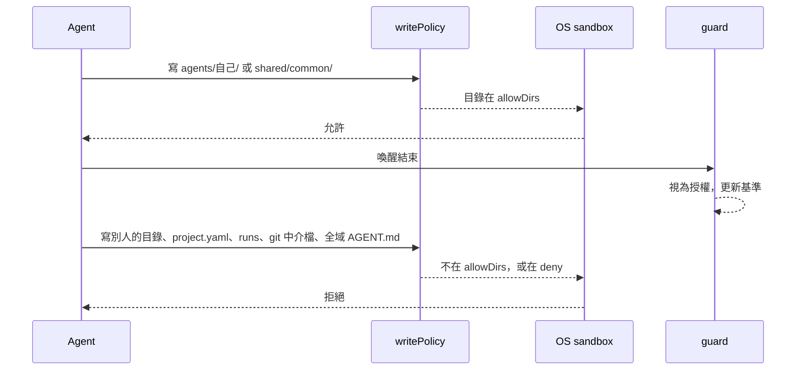

# 放寬自己的專案目錄寫入範圍

狀態：設計已與使用者確認（2026-10-29）。已實作（PR #127）。

## 目標

每位成員可以寫自己專案裡、不屬於別人、也不屬於 dispatcher 的那兩塊：

- `projects/<本專案>/agents/<自己>/`（自己的 `AGENT.md` 與自己的專案記憶）
- `projects/<本專案>/shared/common/`（`COMMON.md` 與 `records/`）

Claude Code 與 Codex 拿到同一份目錄清單。目錄裡沒有仍要保護的檔，所以 Codex 不必在一個可寫根裡面排除單一檔。

## 不在這次範圍

- repo 的 worktree 寫入範圍不變。使用者的主工作目錄仍然不寫。
- repo 的 `CLAUDE.md`／`AGENTS.md` 仍只有 `can_edit_agent_md` 的 lead 能改。交接筆記 `task-memory/<run>/_shared/` 仍只有 lead 能寫。
- `.git` 指標、`commondir`、`config.worktree`、`gitdir` 維持拒絕。
- 別人的 `agents/<別人>/`、記憶、inbox、outbox 維持拒絕。
- 自己的 inbox 仍由 dispatcher 寫入。
- `project.yaml`、`runs/`、`locks/`、`worktrees/`、`cleanup/`、`team.yaml`、其他專案、全域 `agents/` 維持拒絕。
- `sandbox.write` 的 blanket ban 不變：不能指向整份 `~/agent-lyceum-config`、repo 根，或它們的祖先。這次是預設 `allowDirs`，不是 `sandbox.write`。
- 網路、`local_binding`、`unix_sockets` 不改。

## 寫入政策

`writePolicy`（`src/policy.ts`）為每個 agent 的 `allowDirs` 加上：

1. `path.join(project.paths.agentsDir, agent.name)`，也就是 `projects/<本專案>/agents/<自己>/`。這個目錄若含有別人的 `AGENT.md`、記憶、inbox 或 outbox，就不加入（Codex 無法在可寫根裡挖洞）。自己的專案層 `AGENT.md` 與自己的記憶不算別人的。
2. `path.join(project.paths.shared, "common")`，也就是 `shared/common/`。`records/.archive/` 在這個目錄裡，因此一併可寫。

接著調整既有的拒絕清單，使這兩個目錄裡「這位 agent 可以寫的檔」不再被拒絕：

- 自己的專案層 `AGENT.md`（路徑在自己的 `agents/<自己>/` 底下）從 `deny` 拿掉。全域 `AGENT.md`（`~/agent-lyceum-config/agents/...`）留在 `deny`，除非原本的 `can_edit_agent_md` 已允許。
- `COMMON.md` 與 `records/` 從所有成員的 `deny` 拿掉，並從非 lead 的 `readDirs` 拿掉。
- 別人的 `AGENT.md`、記憶、inbox、outbox 仍在 `deny`。
- `can_edit_agent_md` 的 lead 仍可透過既有的 `allowFiles` 改每個 `AGENT.md` 與 repo 的 `CLAUDE.md`／`AGENTS.md`。

實例 2 以上（`frontend--2` 這類）的 `agent.name` 不是角色目錄。它們拿到的是 `agents/<實例名>/`，裡面沒有角色的 `AGENT.md` 與專案記憶；角色那份記憶維持唯讀（`sharedMemory` 與既有 deny）。它們可以寫 `shared/common/`，與其他成員相同。

## Guard

`mayEditProtected` 對「在這位 agent 的 `allowFiles` 裡，或在它的 `agents/<自己>/`、`shared/common/` 裡」的受保護檔回傳 true。因此：

- 成員改自己的專案層 `AGENT.md`、`COMMON.md`：留下，更新基準，不還原。
- 成員改別人的 `AGENT.md`、全域 `AGENT.md`、repo 的 `CLAUDE.md`／`AGENTS.md`：照舊還原（另一個 run 存活且無法歸屬時，仍走現有的 `protected-change-unattributed`）。
- `checkRecords`：本批任一 agent 都算授權。紀錄的新增、修改、刪除留下並更新基準，不再因「不是 lead」而還原。

## Prompt

`src/prompt.ts` 的規則改成與政策一致：

- 可以改 `COMMON.md` 與 `records/`（給出路徑）。
- 只有 `agent.agentMd` 位於 `agents/<agent.name>/` 時，才告知可以改那份 `AGENT.md`。實例 2 以上的 `agentMd` 仍是角色那份，不告知可以改。
- 不可以改別人的 `AGENT.md`、全域 `AGENT.md`、repo 的 `CLAUDE.md`／`AGENTS.md`、別人的記憶與信箱、agent-lyceum 的設定檔。
- 記憶那句「只能寫在這些記憶目錄」改為同時列出實際加入的 `agents/<自己>/` 與 `shared/common/`。
- 實例 2 以上仍被告知不能寫角色的共用記憶；教訓寫進回給 lead 的信。它們可以寫 `shared/common/`。

## Doctor

`writablePaths` 會列出這兩個目錄。`agentMd` 欄位的意義不變：它描述「別人的人設擋得多硬」。自己的專案層 `AGENT.md` 出現在可寫路徑，不把整欄改成可寫。

## 驗收

- 非 lead 的 `writePolicy`：`allowDirs` 含 `agents/<自己>/` 與 `shared/common/`；`deny` 不含自己的專案層 `AGENT.md`、`COMMON.md`、`records/`；仍含別人的 `AGENT.md`、別人的記憶與信箱、`project.yaml`、`runs/`、git 中介檔。
- 全域 `AGENT.md` 仍在 `deny`。
- 實例 2 的 `allowDirs` 含 `agents/<實例名>/` 與 `shared/common/`，不含角色的 `agents/<角色>/`。
- guard：非 lead 改自己的專案層 `AGENT.md`、`COMMON.md`、一筆 record 後不還原；改別人的 `AGENT.md` 會還原。
- prompt 文字與上面的規則一致。
- 既有「lead 才能改 repo `CLAUDE.md`／`AGENTS.md`」的測試仍通過。
