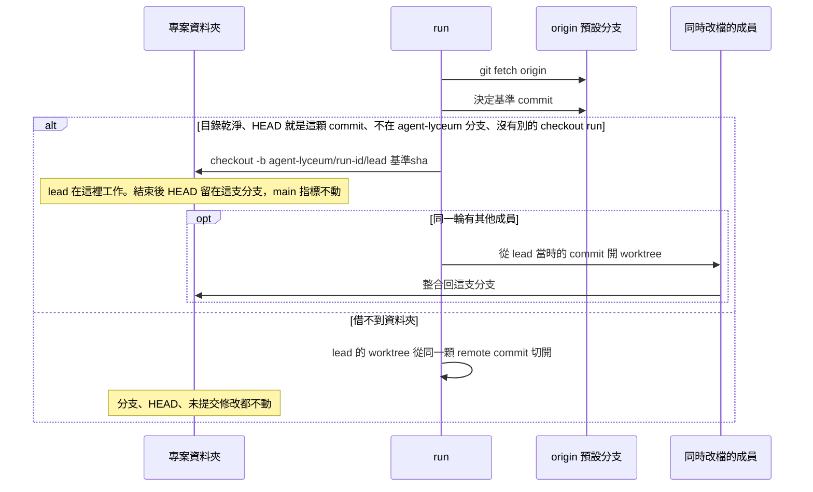

# 預設在工作目錄從 remote 開分支

日期：2026-11-27　狀態：已審閱通過並實作

## 1. 目標

有 commit、且 ref 儲存是 `files` 的 git repo，新的 run **預設不再為 lead 複製一份 worktree**。

它從 `origin` 的預設分支開 `agent-lyceum/<run-id>/<lead>`，並在專案資料夾裡切到這支分支。本地的 `main`／`master` 指標不被移動。run 結束後 HEAD 留在這支分支上。

借不到資料夾時，lead 改用 worktree。基準仍是同一顆 remote commit，使用者的分支與未提交修改保持不動。借不到的條件是：工作目錄不乾淨、HEAD 不是那顆 remote commit、HEAD 已在 `agent-lyceum/*`，或已有別的 run 佔著這個資料夾。

借得到時，lead 留在資料夾裡。同一輪還有其他成員要改檔，那些成員各自開 worktree，做完再整合回這支分支。lead 不會因此改去 worktree。



## 2. 非目標

- 結束時自動切回 `main`／`master`，或自動合併
- fetch `origin` 以外的 remote
- 改 `shared` 模式（非 git、尚無 commit、reftable）：仍直接在資料夾裡輪流工作，不 fetch、不開這支分支
- 為了省磁碟而讓成員排隊共用同一個資料夾
- 接續時把已經在跑的模式改掉
- 跨專案鎖。兩個專案指向同一個 git repo 時，鎖仍只看各自的專案名稱。借用條件裡的「HEAD 不是 `agent-lyceum/*`」只擋「對方剛切完任務分支、還沒 commit」這一種搶走。兩個專案同時從乾淨的 `main` 切分支，這次不處理
- 為 checkout 模式新做一套 pinned git 的快照與整合。`snapshotBase` 與 `integrateAgentChanges` 在沒有 worktree 時仍直接對主 repo 執行一般 git，`.git/config` 裡的 filter 與 fsmonitor 會在 sandbox 外由 dispatcher 跑。這是 `shared` 既有的代價；checkout 把它變成常見路徑，規格接受，不在這次修
- 把推送做成完整隔離。`git push` 只套用 `PINNED_CONFIG`（停用 hooks 與簽章）。`core.sshCommand`、`credential.helper`，以及 `gh` 在主 repo 裡執行的 git，這次不固定。停用 `pre-push` 與比對 push URL 是縮小範圍，不是邊界

## 3. 基準 commit

新函式 `resolveRemoteBase(dir)`，只在 `isolationBlocker(dir)` 為空時呼叫。

1. 執行 `git fetch origin`。環境是 `GIT_TERMINAL_PROMPT=0`，ssh 為 `BatchMode=yes`。逾時 60 秒，逾時與失敗（沒有 `origin`、網路失敗、remote 拒絕）都不讓 run 失敗：印一行，改用本地已有的 remote ref。fetch 不停用 hooks。fetch 只更新 remote-tracking ref，不改本地分支，也不改工作目錄。一般的 fetch 不會更新 `origin/HEAD`（很新的 git 開了 `followRemoteHEAD` 才會）；解析時用當下讀到的值，不假設它剛被更新。
2. 能解析就用 `origin/HEAD` 指向的那支（`git rev-parse --abbrev-ref origin/HEAD` 再 `rev-parse` 成 commit）。remote 的預設分支若是 `develop`，就用 `origin/develop`。
3. 沒有 `origin/HEAD` 時用 `origin/main`。
4. 再沒有就用 `origin/master`。
5. 三者都不存在：這次 run 維持現況，lead worktree 從本地 `HEAD` 切開，並印出原因。

`main` 與 `master` 同時存在、且 `origin/HEAD` 有值時，以 `origin/HEAD` 為準。`origin/HEAD` 沒有值時用 `main`，不用 `master`。

同時讀取 `git remote get-url --push origin`（會展開 `pushurl` 與 `insteadOf`），稍後寫進 state 的 `origin_url`。沒有 origin、或這個指令失敗，就不寫這個欄位。不用 `remote.origin.url`：lead 可以改 `pushurl` 而讓那個值維持不變。

## 4. 啟動時怎麼選

持久化的 `workspace_mode` 是 `"checkout" | "worktree" | "shared"`。執行期的 plan 不新增模式值。checkout 這條路沿用已經存在的 `{ mode: "worktree", leadWorktree: false }`，再加一個 `taskBranch`（分支全名）。`pickBatch`、成員快照、整合、`instanceCap`、`recover` 都看 `mode === "worktree"`，因此不用逐一改條件。`leadWorktree: false` 表示 lead 沒有自己的 worktree，人在專案資料夾。

`run --agent` 與 `run --tidy` 走同一套選擇。分支名的 lead 就是該 run 的 lead；solo 時就是那個成員。整理記憶的 `tidy` 指令不是 run，不開分支。

`planWorkspace` 在取鎖之前只決定**意圖**。真正變成 checkout 只發生在 CLI 完成下面的鎖流程之後，並把最終 plan 傳進 `runTeam`。`dispatcher.ts` 的 `runTeam` 在沒有傳 plan 時會自己呼叫 `planWorkspace`。那條路徑只有**新 run** 得到 checkout 意圖時才降為 worktree（lead worktree 從基準 commit 切），不借資料夾。接續的 checkout run 不降級：沒有 lead worktree，降級後 `existingAgentWorkspace` 會丟錯。

執行期的 `mode` 是 `"worktree"`，但寫進 state 的 `workspace_mode` 在有 `taskBranch` 時必須是 `"checkout"`。`RunSession` 建構子今天把 `workspace_mode` 設成 `wsMode`（新 run 與接續都是），也會經 `newRunState` 寫成 schema 2。這兩處在有 `taskBranch` 時改寫 `"checkout"`，並保留先寫下的 schema 4、`base_ref`、`base_sha`、`origin_url`、`task_branch`、`checkout_from`。`taskBranch` 來自 state 的 `task_branch`，不從當下的 `project.yaml` lead 重算；使用者之後改了 lead，HEAD 檢查仍對到原來的分支。

| 持久化模式 | 何時 | 執行期 plan | 鎖 |
|---|---|---|---|
| `checkout` | 有基準 commit，而且借得到資料夾 | `{ mode: "worktree", leadWorktree: false, taskBranch }` | 先 `checkout: true` |
| `worktree` | 有基準 commit 但借不到；或沒有任何 remote 基準；或鎖流程中途改道 | `{ mode: "worktree", leadWorktree: true }` | `checkout: false` |
| `shared` | `isolationBlocker` 有原因 | `{ mode: "shared", leadWorktree: false }` | `checkout: true`（與現在相同） |

借得到資料夾，四項都要成立：

- `dirtyPaths(project.dir)` 是空的（含未追蹤、未被 ignore 的檔案）
- `HEAD^{commit}` 等於基準 commit。人在別的分支上但那個分支指向同一顆 commit（或 detached HEAD 停在那顆 commit）也算借得到。本地 `main` 比 `origin/main` 超前或落後一顆 commit，就借不到
- `git symbolic-ref -q HEAD` 不是 `refs/heads/agent-lyceum/*`。detached HEAD 沒有 symbolic-ref，這一項算通過
- 沒有別的存活鎖的 `lockKind` 是 `checkout`

### 4.1 鎖

`takeLock` 今天碰到 checkout 被佔用會直接結束行程，`ProjectLease` 也沒有把已拿到的 checkout 鎖降級的 API。流程改成：

1. 意圖是 checkout 時，先以 `checkout: true` 取鎖。`project-lock.ts` 的 `checkoutBusyError` 今天回傳一般的 `Error` 且沒有 export；改成有 export、可辨識的錯誤型別。`cli.ts` 的 `takeLock` 碰到這個型別就改以 `checkout: false` 重取，plan 改成 worktree，run 不失敗。其他取鎖錯誤仍失敗。
2. 拿到 checkout 鎖之後、寫入任何 run 檔或切分支之前，再查一次乾淨、HEAD commit、以及不在 `agent-lyceum/*`。不再成立：`release()`，再以 `checkout: false` 重取，plan 改成 worktree。自己持有 checkout 鎖時，別的 run 不可能同時持有 checkout 鎖，規格不寫這個情境。
3. 改道的原因寫進 run log。那一行在 state 可寫之後補上；改道發生在 state 出現之前時，印在 stderr。

### 4.2 `checkout`

切分支之前就把 state 寫下，避免切過去之後、寫檔之前被強制結束時，HEAD 停在新分支上卻沒有 run 可接。這份 state 的 `schema_version` 是 4，並含：

- `workspace_mode: "checkout"`
- `lead_workspace` 不設
- `task_branch`：`agent-lyceum/<run-id>/<lead>`，接續與清除都讀這個欄位
- `base_ref`：例如 `origin/main`
- `base_sha`：切開時的 commit
- `origin_url`：啟動時的 push URL，沒有就不寫
- `checkout_from`：啟動前的 `HEAD`（分支名，或 detached 時的 sha）。還原、以及接續被拒時的提示都用它
- `task_sent` 先不寫。任務信送出之後才設為 `true`。沒有這個欄位表示啟動還沒完成

然後：

```
git checkout -b agent-lyceum/<run-id>/<lead> <基準 sha>
```

用 `-b`，不用 `-B`。分支已存在就中止這次啟動，不重設它。checkout **不停用** hooks，讓 git-lfs 的 `post-checkout` 能取出檔案。HEAD 是否已離開原位，用切換前後的 `symbolic-ref`（沒有則用 `rev-parse HEAD`）比較，不看結束碼。hook 失敗但 HEAD 已經在新分支上，視同切換已完成。

`git checkout -b` 失敗且 HEAD 尚未離開原位：釋放鎖，刪掉整個 run 目錄（含 `task.md` 與 `log.jsonl`，不只 `state.json`）。切換已完成、任務信還沒送出就失敗：`git checkout` 回 `checkout_from`，新分支沒有自己的 commit 時刪掉它，還原成功後同樣刪掉整個 run 目錄。還原再失敗時，留下目前的 HEAD、新分支與 state，錯誤訊息寫出 HEAD 與分支名，不第二次切換。

印一行：從哪個 ref、哪顆 sha 開始，lead 在專案資料夾的哪支分支上工作。

這個模式的受保護檔案檢查與 `verify` 工作目錄都是專案資料夾，與 `shared` 相同。沒有 lead worktree 時，`compareWithLastRejection` 得到 `no-worktree`，「同樣失敗且內容相同就提早停止」不啟用。這是預期，與 `shared` 相同。驗證指令本身仍會跑。

`run` 的 schema：`STATE_SCHEMA_VERSION` 升到 4。checkout run 從這份先寫下的 state 就是 4。非 checkout 的新 run 仍是 `NEW_RUN_SCHEMA_VERSION`（2）；開 instances 時仍升到 3。`RunSession.routing().enable` 今天無條件寫 `state.schema_version = 3`；版本已是 4 時不寫 3。舊版只支援到 3 的程式在 `assertSupportedVersion` 拒絕 4，不會把 checkout 當成 `shared` 接續。

### 4.3 借不到時的 `worktree`

與現在的隔離相同，只有起點不同：lead worktree 與 `refs/agent-lyceum/<run-id>/base-0` 指向基準 commit，不指向本地 `HEAD`。沒有 remote 基準時，`base-0` 仍是本地 `HEAD`（現況）。`prepareAgentWorkspace` 已接受任意 ref，不需要新機制。

HEAD 不是 `agent-lyceum/*`、且 commit 與基準不同時，多印一行：本地尚未進入這顆 commit 的提交不在這次 run 裡。HEAD 正停在別的 run 的 `agent-lyceum/*` 時，改印：工作目錄正停在另一個 run 的分支，這次 run 改在 worktree，從基準 commit 開始。未提交的檔案本來就不在 run 裡。

使用者的工作目錄、index、HEAD 都不改。

有 remote 基準的 worktree run 也寫 `base_ref`、`base_sha`、`origin_url`。沒有 remote 基準的不寫。有 `base_ref` 時，第 5.4 節的 PR base 與 push URL 檢查同樣適用。

worktree 模式的 follow-up 要重切 lead worktree 時，不從 `base_sha` 切：那是上一段開始前的 commit，新 worktree 會少掉已經合併的成果。`symbolic-ref` 不是 `agent-lyceum/*` 時，起點仍是本地 `HEAD`（現況的 `snapshotHead`，含已合併的成果與使用者之後的提交）。HEAD 在 `agent-lyceum/*` 時不重切，沿用原本的 lead worktree。沒有這次新增欄位的舊 run 用同一條規則。

### 4.4 同時改檔的成員

執行期 `mode === "worktree"` 時，同一輪所有待處理的非 lead 成員平行喚醒。`shared` 仍一次只有一個人。

`leadWorktree: false`（checkout）時：

- 快照之前先確認 `git symbolic-ref -q HEAD` 是 `refs/heads/` 加上 `task_branch`。不是：比照現有的快照失敗，設 `endReason` 為 `lead_failed` 並停止。不留在迴圈裡空轉（成員沒有 worktree 就不會被喚醒，`rounds` 也不增加，`max_rounds` 到不了）
- 整合之前做同樣的確認。不是：走 `refusedIntegration`，寫入 `blocked_integrations` 並通知 lead。不只記 note；否則成員的回覆仍會送達，檔案卻沒進來
- 確認通過後，快照用現有的 `snapshotBase`，不傳 lead worktree，讀的是專案資料夾
- 成員的 worktree 從那顆快照切出（現有 `prepareAgentWorkspace`）
- 整合用現有的 `integrateAgentChanges`，不傳 target，寫回專案資料夾
- lead 沒有 `worktrees/<run-id>/<lead>`

成員 worktree 只在該成員這輪真的被喚醒時建立。

## 5. 結束、接續、清除、開 PR

### 5.1 結束

`waiting` 不提交，與現在相同。`checkout` 時 HEAD 留在任務分支上，工作目錄維持 agent 留下的樣子。

其他結束原因要提交時，用新的 `finishCheckoutBranch`，不呼叫 `commitWorkspace`（那個函式要求 `AgentWorkspace`，並靠 `assertWorkspaceIntact` 確認 HEAD 是 worktree 自己的分支）。`finishCheckoutBranch` 在主 repo 上套用與 `PINNED_CONFIG` 相同的設定：`core.hooksPath=/dev/null`、停用簽章、dispatcher 身分。提交前 `git symbolic-ref -q HEAD` 必須是 `refs/heads/` 加上 state 的 `task_branch`。不是：不提交、不設 `result_branch`、記一筆 note。是：index 沒有變更就不建立 commit；有變更才提交。訊息與 trailers 沿用 `finishLead`。寫出 `runs/<run-id>/lead.patch`，並印 `git merge agent-lyceum/<run-id>/<lead>`。不切回 `checkout_from`，不移動 `main`／`master`。

`worktree` 模式仍只在 lead 的 worktree 裡提交，不碰專案資料夾。`verify` 的工作目錄維持 lead worktree。

### 5.2 接續

接續沿用 state 裡的模式，不重新選擇。`planWorkspace(resume)` 看到 `workspace_mode: "checkout"` 時回傳 `{ mode: "worktree", leadWorktree: false, taskBranch }`，`taskBranch` 讀 `task_branch`，不落到 `shared`。

`task_sent` 不是 `true` 的 checkout state 是中止的啟動，不接續：

- 分支不存在，或 HEAD 仍是 `checkout_from`：刪掉整個 run 目錄，印出啟動沒有完成。不要求使用者切到一支不存在的分支。若 `task_branch` 已存在且尖端仍是 `base_sha`，一併刪掉該分支。
- HEAD 已在 `task_branch`、尖端仍是 `base_sha`、工作目錄乾淨：切回 `checkout_from`，刪掉沒有自己 commit 的分支，再刪掉整個 run 目錄。
- HEAD 已在 `task_branch` 但已有自己的 commit 或未提交修改：拒絕，印出分支名與 `checkout_from`，不刪檔、不切換。

`task_sent` 為 `true` 時，`continueRun` 在取鎖之後、與現有的 state 重讀放在一起，才檢查 HEAD。checkout 取 checkout 鎖；鎖被佔用就拒絕，不改成 worktree。HEAD 的 `symbolic-ref` 仍是 `task_branch` 就繼續。已經離開：拒絕，印出要切回的分支，不自行切換，也不改成 worktree。

接續不要求工作目錄乾淨。`waiting` 期間使用者在任務分支上改的、未被 ignore 的檔案，會在之後結束時由 `finishCheckoutBranch` 的 `add -A` 一起提交。

追加要求不重切分支，不呼叫 `recutLeadWorkspace`。使用者若已把任務分支合併並切走，再下追加要求會被「HEAD 已經離開」拒絕，必須先切回那支分支（即使它已經合併）。

### 5.3 清除

`clear` 在 `checkout` 模式、且 `symbolic-ref` 正是 `task_branch` 時拒絕，並說明要先切到別的分支。不代替使用者切換。

HEAD 已離開時，lead 的任務分支是一種新的 cleanup 項目（它沒有 `worktrees/<run-id>/<lead>`，現有的 `planRunCleanup` 不會看到它）：

- 刪分支的條件是 `refs/heads/<task_branch>` 的尖端是目前 HEAD 的祖先（`merge-base --is-ancestor <tip> HEAD`）。不用 `result_branch.head`：使用者在 run 結束後又在任務分支上提交，那些 commit 的尖端不是 HEAD 的祖先，刪掉（`branch -D`）會丟掉它們。
- squash merge 後尖端通常不是祖先，不刪。
- 沒有 `result_branch`：不刪這支分支。clear 仍會刪 run 目錄，所以在保留清單印出分支名與原因（沒有已記錄的結果 commit）。
- 成員 worktree 裡「有沒有尚未進入 repo 的成果」改為對照 `result_branch.head`（沒有則對照任務分支尖端），不對照當時的 `HEAD`。否則 HEAD 已經離開任務分支時，已整合、尚未合併的成果會被誤判成還在 worktree 裡。

`--keep-worktrees` 保留成員 worktree，也保留這支 lead 任務分支，並在保留清單印出它。

### 5.4 開 PR

`open_pr: true` 在 `checkout` 模式一樣有效。要推的是 `result_branch.branch`。沒有 `result_branch`、或該分支沒有檔案變更時略過。

推送從主 repo 執行，但 checkout 模式下主 repo 就是 lead 的工作目錄，現有「沒有 lead worktree 就略過」是一道安全界線，不能直接拿掉。改成：

- `git push` 套用 `PINNED_CONFIG`（至少 `core.hooksPath=/dev/null`），不跑使用者的 `pre-push`。ssh 與 credential helper 不在這次的固定範圍內，見第 2 節
- 推之前再跑 `git remote get-url --push origin`，與 state 的 `origin_url` 不同，或當時沒記下 URL：不推，印出可手動完成的指令
- 有 `base_ref` 時（checkout 與 worktree 都算），PR 的 base 用 `base_ref` 去掉 `origin/` 的分支名（`origin/main` → `main`）。不呼叫 `defaultBase` 的 `gh` 後備
- 沒有 `base_ref` 的 worktree run（含舊 run）推送路徑與 base 維持現況

## 6. 模組

| 單位 | 做什麼 | 依賴 |
|---|---|---|
| `resolveRemoteBase` | 有時限地 fetch，挑出 ref、sha 與 push URL | 只呼叫 git |
| `planWorkspace` | 回傳意圖：`mode`、`leadWorktree`、`taskBranch`、`baseRef`、`baseSha`、`reason`。resume 的 `taskBranch` 讀 `task_branch` | `resolveRemoteBase`、`dirtyPaths`、存活鎖 |
| `project-lock.ts` | export 可辨識的 checkout busy 錯誤 | 現有的 `checkoutBusyError` |
| CLI 鎖流程 | busy 或取鎖後條件失敗時釋放並改取 worktree 鎖 | 上面的錯誤型別、`takeLock` |
| `checkoutLeadBranch` | 先寫 schema 4 的 state（含 `task_branch`，尚無 `task_sent`），再切分支；失敗時刪整個 run 目錄 | git |
| `finishCheckoutBranch` | 確認 HEAD 是 `task_branch` 後，在主 repo 以 pinned git 提交並寫 patch | `PINNED_CONFIG`（要 export）、`finishLead` 的訊息 |
| `RunSession` | 有 `taskBranch` 時 state 維持 `checkout` 與 schema 4。`routing().enable` 不把 4 寫成 3。未帶 plan 只對新 run 降級。快照前 HEAD 不符則 `lead_failed`；整合前不符則 `refusedIntegration` | 上面幾個 |
| `planRunCleanup` | checkout 的 lead 分支獨立成一項。刪除條件是分支尖端為 HEAD 的祖先。留著的分支印在保留清單 | 現有 cleanup journal |

## 7. 錯誤處理

- fetch 逾時或失敗：繼續，使用本地 remote ref
- 沒有 remote 基準：worktree 從本地 `HEAD` 開始
- checkout 鎖 busy，或取到鎖後條件不再成立：釋放後改取 worktree 鎖，不中止 run
- `git checkout -b` 失敗且 HEAD 未動：刪掉整個 run 目錄，釋放鎖
- `git checkout -b` 已切過去才失敗、任務尚未送出：還原 HEAD，刪掉沒有自己 commit 的新分支與整個 run 目錄。還原失敗則留下 state 與 HEAD
- 快照前 HEAD 不是 `task_branch`：以 `lead_failed` 結束，不改 HEAD
- 整合前 HEAD 不是 `task_branch`：`refusedIntegration`，通知 lead，不改 HEAD
- 提交時 HEAD 不是 `task_branch`：不提交、不設 `result_branch`
- `task_sent` 尚未寫下就來接續：依第 5.2 節當成中止的啟動，不進入空轉的 idle
- 任務已送出、但人已不在任務分支上，或 checkout 鎖被佔用：拒絕，提示切回
- 推送前的 push URL 與 `origin_url` 不同：不推，印手動指令

## 8. 測試

先寫失敗測試再實作：

1. 乾淨且 `HEAD` 等於 `origin/main`：切到 `agent-lyceum/<run>/<lead>`，沒有 lead worktree；本地 `main` 的 sha 不變；結束後 HEAD 仍是任務分支；state 的 `schema_version` 是 4。
2. 工作目錄有未提交檔案：lead worktree 的起點是 `origin/main` 的 sha；使用者的 HEAD 與那些檔案不變。
3. 本地 `main` 比 `origin/main` 多一個 commit：走 worktree；本地 `main` 不變。
4. 已有別的 checkout 鎖：新 run 以 worktree 鎖重取並成功，不結束行程。取到 checkout 鎖後目錄變髒：釋放後改取 worktree 鎖，且在改道前沒有寫下 checkout state。
5. 兩個 worktree run 仍可同時跑。一個 checkout run 與一個 worktree run 可同時跑。第二個 checkout run 不借用資料夾。HEAD 已在 `agent-lyceum/*` 時不借用。
6. checkout 模式下，同一輪的成員有自己的 worktree，整合結果出現在專案資料夾的任務分支上。lead 沒有 worktree。快照前 HEAD 被改離任務分支時，run 以 `lead_failed` 結束，不空轉。整合前 HEAD 不符時走 `blocked_integrations` 並通知 lead。
7. 沒有 `origin/main` 也沒有 `origin/master`：worktree 從本地 `HEAD` 開始，並有原因訊息。`origin/HEAD` 指向 `origin/develop` 時用那顆 commit。兩者都在且沒有 `origin/HEAD` 時用 `main`。
8. `git fetch origin` 失敗、本地已有 `origin/main`：用那顆 commit，輸出含一行說明。fetch 的環境含 `GIT_TERMINAL_PROMPT=0`。
9. checkout run 在仍停在任務分支時可以接續。HEAD 改到別處後接續被拒絕，且不會切換分支。追加要求在人已離開分支時同樣拒絕。
10. `waiting` 不提交。其他結束會在任務分支上產生 commit，`main` 不移動。提交當下 HEAD 不是任務分支：沒有 commit，也沒有 `result_branch`。
11. 非 git、無 commit、reftable 仍是 `shared`。未傳 plan 的新 `runTeam` 不把乾淨的 repo 切到新分支。未傳 plan 的 checkout 接續不降成 lead worktree。
12. `clear` 在 HEAD 正是任務分支時拒絕。HEAD 已離開、且分支尖端是 HEAD 的祖先時才刪 lead 分支。尖端比 `result_branch.head` 多出的 commit 不刪。squash 後不刪。沒有 `result_branch` 時不刪，並在保留清單印出原因。`--keep-worktrees` 保留該分支。
13. `checkout` 模式、`outcome: completed`、分支有檔案變更、且 `done` 帶 `open_pr: true` 時，推的是這支本地分支，push 停用 hooks，PR base 是 `base_ref` 的分支名。比對的是 `git remote get-url --push origin`：`pushurl` 改了而 `remote.origin.url` 沒變時不推。
14. `assertSupportedVersion(4, 3, ...)` 拒絕。`routing().enable` 不把 checkout run 的 schema 4 寫成 3。建構子跑完後 `workspace_mode` 仍是 `checkout`，`task_branch` 仍在。之後改 `project.yaml` 的 lead，接續仍用原來的 `task_branch`。
15. checkout 模式的 verify 重複失敗不因「內容相同」提早停止（`no-worktree`）。
16. worktree 的 follow-up 重切起點是本地 HEAD，不是 `base_sha`。HEAD 在 `agent-lyceum/*` 時不重切。
17. `task_sent` 尚未寫下、分支也不存在時，接續刪掉整個 run 目錄，不要求切到那支分支。分支已切過去但沒有自己的 commit、目錄又是乾淨的：切回 `checkout_from` 並刪掉 run 目錄。已有自己的 commit 時拒絕且不刪。

## 9. 文件

行為變更寫進 `docs/how-it-works.md`、`docs/how-it-works.zh-TW.md`、`docs/commands.md`、`docs/commands.zh-TW.md`、`docs/configuration.md`、`docs/configuration.zh-TW.md`：預設從 remote 開分支、什麼情況改開 worktree、結束後 HEAD 留在任務分支、接續時人必須還在該分支、兩個專案共用一個 repo 時沒有跨專案鎖。
